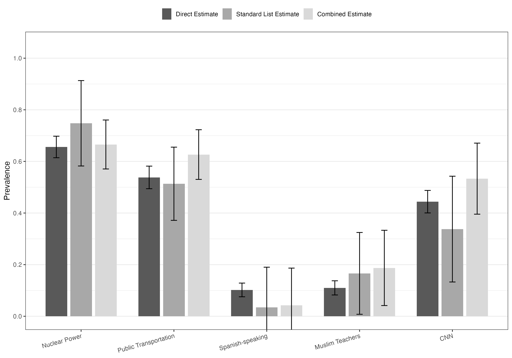
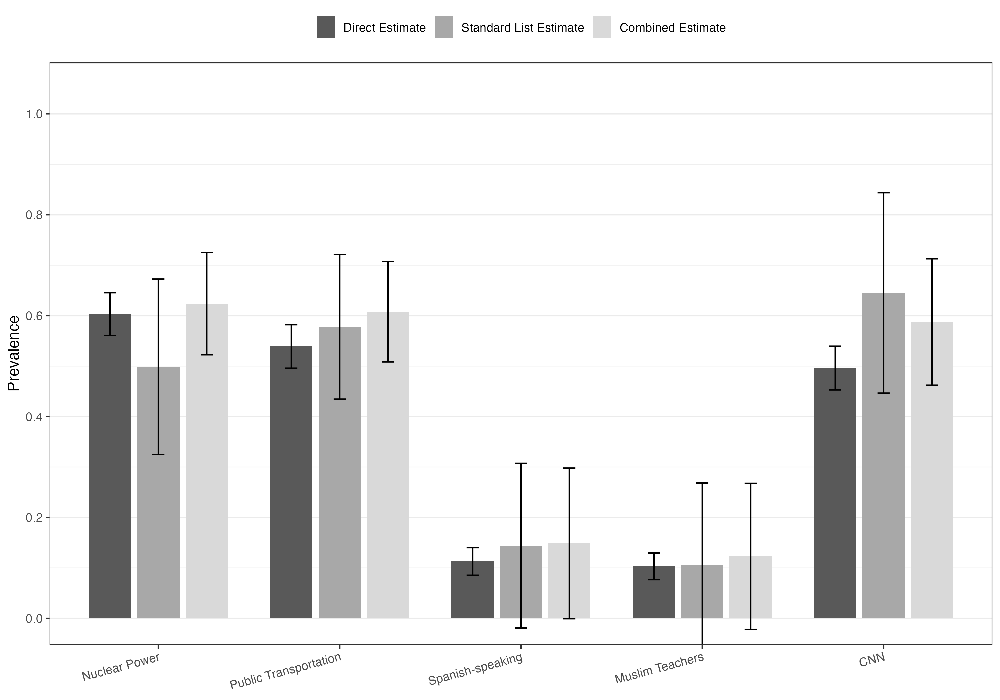
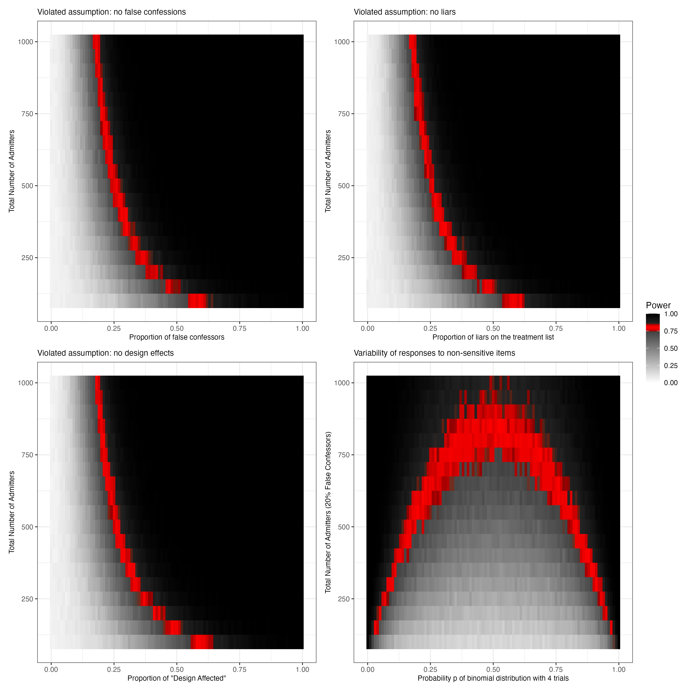
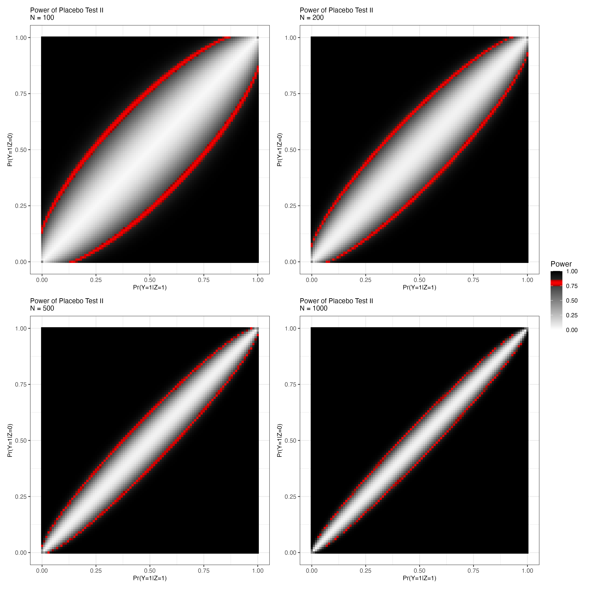

# Active Maintenance Report: aronow_etal_2015

2026-08-03

- [Summary](#summary)
  - [Does the deposited archive run?](#does-the-deposited-archive-run)
  - [Does the maintained rewrite reproduce the
    paper?](#does-the-maintained-rewrite-reproduce-the-paper)
- [Paper overview](#paper-overview)
- [Original archive reproducibility](#original-archive-reproducibility)
  - [The three errors in the power
    script](#the-three-errors-in-the-power-script)
  - [No seed anywhere](#no-seed-anywhere)
  - [The sampler changed underneath the
    simulation](#the-sampler-changed-underneath-the-simulation)
  - [What the archive writes where](#what-the-archive-writes-where)
- [Checksums](#checksums)
- [Number-by-number comparison](#number-by-number-comparison)
  - [What the article says in prose](#what-the-article-says-in-prose)
- [Maintained rewrite](#maintained-rewrite)
  - [Architecture](#architecture)
  - [Deprecated patterns replaced](#deprecated-patterns-replaced)
  - [Two choices worth stating](#two-choices-worth-stating)
- [Figure verification](#figure-verification)
- [Maintained rewrite verification](#maintained-rewrite-verification)
  - [Claims the article makes about shape rather than
    value](#claims-the-article-makes-about-shape-rather-than-value)
- [R environment](#r-environment)

*Drafted by Claude Opus 5 under the supervision of Alex Coppock.*

This repository holds the actively maintained replication code for
Aronow, Coppock, Crawford and Green (2015), together with the
reproducibility report that documents what the original archive did and
did not do. It is part of a program applying the maintenance proposal in
Peer, Orr and Coppock (2021, *PS: Political Science & Politics*, doi
[10.1017/S1049096521000366](https://doi.org/10.1017/S1049096521000366))
to a set of published archives.

|  |  |
|----|----|
| Article | [10.1093/jssam/smu023](https://doi.org/10.1093/jssam/smu023) |
| Replication archive | [10.7910/DVN/29984](https://doi.org/10.7910/DVN/29984) |

**The data are not redistributed here.** The deposit is 253 KB across
eight files and lives at Harvard Dataverse, which is the only copy this
repository points at. `download_original.R` fetches it and verifies
every file on checksum and on byte size, and stops if `original/` holds
anything the manifest does not list; `original_manifest.csv` pins the
file identifiers, sizes and checksums, so the exact bytes this code was
written against are recorded in version control even though the bytes
themselves are not.

**Repository layout.** `maintained/` is the maintained rewrite: one
script per published table or figure, writing to `output/`, which is
committed so a reader can compare a fresh run against it without
downloading anything. `ground_truth/` ties every published number to the
code that produces it. `published_claims.csv` is the transcription:
every numeric token in the article and the online supplement, read off
the page and classified by hand. `run_archive.R` runs the deposited
scripts in a scratch copy and records what they compute, and
`build_ground_truth.R` joins the transcription to that run and to the
rewrite's own output. `maintained/in_text_claims.R` then prints every
claim the article makes in prose beside the sentence that makes it,
recomputing each number from the same output files by a path independent
of the ground truth's. `original/` is created by the download script and
is deliberately absent from the repository. This file is the
reproducibility report, also available as a PDF in `report/`.

**License.** CC0 1.0 Universal, matching the terms of the deposit this
repository maintains. See `LICENSE`.

**To reproduce.** Clone or download the repository, open
`aronow_etal_2015.Rproj`, and run:

``` r
source("run_all.R")
```

That fetches the deposit, verifies its eight files, produces every table
and figure into `maintained/output/`, runs the deposited scripts in a
scratch copy, rebuilds the ground truth, prints every claim the article
makes in prose beside the number the pipeline computes for it, and
verifies the deposit a second time so that a script that damaged it
during the run is caught by the run itself. Required packages:
tidyverse, patchwork, here, knitr and kableExtra for the rewrite and the
report, plus xtable, lmtest and lattice, which the deposited scripts
load and which the verification steps therefore need. All are on CRAN,
and lattice ships with R. Paths resolve through `here`, so nothing
depends on the working directory. A successful run overwrites
`maintained/output/`, which is committed: **`git diff` on that folder is
the reproduction check.**

The run is dominated by one step. The tables and the two prevalence
figures take a few seconds each; the Figure A1 power simulation covers
7,676 grid cells at 1,000 simulated experiments apiece and took 11
minutes of the 12.3 the whole run took on the machine described at the
end of this report. `run_all.R` writes its own timings to
`run_timings.csv`, so those two figures are measurements from the run
behind this page rather than remembered ones.

# Summary

Two questions, answered before the detail.

## Does the deposited archive run?

Not as deposited. Three things stand in the way, and the third is a bug
in the deposited code rather than a stale path or a forgotten package.

All four analysis scripts open with a `setwd()` to a directory that
exists on nobody's machine. Two of them name the first author's home
folder in 2015; the other two call `setwd()` with no argument at all,
which parses and then fails. Every script stops on its first line.
Commenting the call out and running from the archive root is enough for
two of the four, and those two then run clean.
`ACCG_list_replication_experiment.R` needs one more thing: it calls
`xtable()` seven times and never loads the package, which the script
beside it does load.

The fourth, `ACCG_list_placebo_I_power.R`, needs three further edits,
and one of them is a defect in the deposited source file rather than in
the caller. `list_simulator()` in `ACCG_list_source.R` reads its p-value
with `placeboI_test(...)$p_value`, but `placeboI_test()` returns a named
numeric vector, and `$` on an atomic vector is an error in every version
of R there has ever been. The function therefore fails on its first
call, which means the deposited code cannot have produced the published
Figure A1. The power script also calls `listsimulator()`, which does not
exist under that name, and passes dot-separated argument names to a
function whose formals are underscore separated. With all three fixed,
the script runs to completion.

None of this changes a published number. 561 of the 632 recorded claims
reproduce from the deposited scripts and none fails; the remaining 71
cover quantities the deposited scripts never compute, which is most of
them, since the deposit prints tables and states nothing in prose.

## Does the maintained rewrite reproduce the paper?

Every number in a published table does, as does every number the article
states in prose, except the readings it takes off one figure. 580 of the
632 recorded claims match the page at the precision the page prints, 4
do not, and 48 state no number to be compared against, being either the
23 claims the article makes about shape, sign or count, or quantities it
describes without printing. All 548 cells of the 16 published tables
match, as do the sample sizes, ranges and effect magnitudes stated in
prose.

The 4 that do not are all readings of one figure, and the fault lies
with what the deposit can establish rather than with either the rewrite
or the article. Section 4.1 and Appendix C take power off the Figure A1
grid at four points, one of which both passages state, and give the
answers as "about 30 percent", "approximately 80 percent" and "80%
power". The rewrite's simulation puts those points at 30.7, 78.9, 80.5
and 80.6 percent, so all but one of them prints something else at the
precision the page uses. A grid cell is 1,000 simulated experiments, so
its standard error at power 0.8 is 1.3 percentage points, wider than the
last digit either passage prints, and the deposit sets no seed, so the
published figure is one unlabelled draw. 1 of these points falls exactly
half a printed digit from the page and rounds either way. The claims are
right to the precision they can be made at and cannot be checked to the
precision they are written at.

The four figures print no numbers, so each is checked against something
other than the page. Figures 1 and 2 are drawn from the Table 3 and
Table 6 output files rather than recomputed, so the check is that the
plotted values are those values, and the build stops if they are not.
Figure A2 is analytical, so the deposited script is run and its grid
compared with the rewrite's cell by cell: the two agree to 1.1^{-16}
across all 40,796 cells where the power calculation is defined, and the
eight cells where it is not are the same ones in both. Figure A1 is a
Monte Carlo simulation for which the deposit sets no seed, so it can be
reproduced only up to simulation error of about 0.016 at power 0.5; the
rewrite seeds each of its 7,676 grid cells separately, which makes it
reproducible run to run and independent of the number of cores
available.

# Paper overview

**Citation**: Aronow, P. M., Coppock, A., Crawford, F. W. and Green, D.
P. (2015). "Combining list experiment and direct question estimates of
sensitive behavior prevalence." *Journal of Survey Statistics and
Methodology*, 3(1), 43-66. DOI: 10.1093/jssam/smu023

**Summary**: List experiments protect respondents from having to admit a
sensitive behavior directly, at a heavy cost in precision, because the
estimate is a difference in means between long and short lists. The
paper's point is that the direct question and the list experiment can be
combined: under Monotonicity, subjects who answer "Yes" to the direct
question are known to hold the attitude, so the list experiment only has
to estimate prevalence among the subjects who answered "No". The
combined estimator takes the direct question answer at face value where
it is informative and uses the list experiment on the remainder, and its
sampling variance is substantially smaller than the conventional list
estimator's.

Two Mechanical Turk experiments test it, each crossing question order
with five parallel list experiments and direct questions. Study A asks
the direct questions first, Study B asks the lists first, and subjects
are assigned at random between them, so the design is factorial and the
order effect is itself estimable. Three of the five items are not
sensitive (nuclear power, public transportation, CNN) and two are
(whether Spanish speakers should be discouraged, whether Muslims should
not teach in public schools). The main experiment has 1,014 complete
cases and a replication ten months later has 1,012. Reductions in
estimated sampling variance run from 14 to 67 percent. The paper also
proposes two placebo tests: the first checks that the list experiment
estimate equals one among self-identified admitters, and the second
checks that the list treatment does not change the direct question
answer, which it does for nuclear power and for CNN in Study B.

# Original archive reproducibility

| Script | Status on current R | Resolution |
|:---|:---|:---|
| ACCG_list_source.R | Sourced by three of the four scripts; list_simulator() errors on every call | placeboI_test(...)\$p_value becomes \[\["p_value"\]\] |
| ACCG_list_main_experiment.R | Stops on setwd(); clean afterwards | Comment out setwd(); run from the archive root |
| ACCG_list_replication_experiment.R | Stops on setwd(); then calls xtable() without loading it | Add library(xtable); the library(lmtest) call is unused |
| ACCG_list_placebo_I_power.R | Stops on setwd(); then three further errors | listsimulator() becomes list_simulator(); N.trueadmitter and the other dot-separated arguments become underscore separated |
| ACCG_list_placebo_II_power.R | Stops on setwd(); clean afterwards | Comment out setwd() |

Original archive reproducibility, checked against R 4.6.0 on 3 August
2026.

Every package the archive names is still available: `xtable` and
`lmtest` from CRAN, `lattice` with R itself, and `parallel` in base R.
None is unmaintained and none needed substituting for availability. The
rewrite drops `xtable` and `lattice` on grounds of output format rather
than survival, and drops `lmtest` because the script that loads it never
calls it.

## The three errors in the power script

The interesting failure is not the paths. It is that
`ACCG_list_source.R` deposits a function that cannot execute:

``` r
reject_null <- as.numeric(placeboI_test(V=V, Z=Z, Y=Y)$p_value<0.05)
```

`placeboI_test()` returns `c(est = , se = , p_value = , n = )`, an
atomic vector with names, and `$` is not defined on atomic vectors.
Every call to `list_simulator()` raises "\$ operator is invalid for
atomic vectors". The published Figure A1 exists, so the code that made
it was not the code that was deposited; somewhere between the analysis
and the deposit the function was rewritten to return a vector and its
one caller was not updated with it.

`ACCG_list_placebo_I_power.R` then compounds the problem twice over. It
calls `listsimulator()`, which nothing defines, and it passes
`N.trueadmitter`, `N.falseconfessor`, `N.withholder`, `N.innocent`,
`pr.listliar` and `pr.designaffected` to a function whose arguments
carry underscores. Either error alone would stop the script on its first
grid cell.

All three are unambiguous naming and indexing slips rather than
analytical choices, so the maintenance run fixes them and the rewrite
reimplements the simulation from the same specification. Once fixed, the
deposited script runs to completion and produces a Figure A1 that looks
like the published one. It is not run as part of this repository's
pipeline, because it sets no seed and so returns a different grid every
time it is called: there is nothing in one draw of it for the rewrite to
be compared against. What the rewrite is compared against instead is set
out under *The sampler changed underneath the simulation* below.

## No seed anywhere

The deposit sets no seed in any script. Two of the four scripts are
deterministic and it does not matter. The third,
`ACCG_list_main_experiment.R`, computes five chi-squared tests by Monte
Carlo with `simulate.p.value = TRUE`, but none of those five p-values
appears in the published Table 2, so nothing is at stake. The fourth is
a Monte Carlo power analysis over 7,676 grid cells at 1,000 simulations
each, and there the absence of a seed means the published figure cannot
be reproduced cell for cell by anyone, including the authors. At power
0.5 the standard error of a cell is 0.016, which is invisible at the
resolution the figure is drawn, so nothing the appendix argues from the
figure turns on it. It does put the appendix's one numeric reading of
the figure, 80 percent power at 800 admitters, beyond what a single grid
can settle. The rewrite seeds every cell.

## The sampler changed underneath the simulation

R 3.6.0 replaced the algorithm behind `sample()`, and the Figure A1
simulation calls `sample()` four times per simulated experiment, so a
2015 analysis cannot be re-run under the current default and get the
draws it got then. `text_placebo_i_sampler.R` runs a coarse slice of the
first panel under each sampler from identical per-cell seeds and
measures the gap. Across 77 cells the mean absolute difference is 0.0053
and the largest is 0.036, against a simulation error of 0.016 for a
single cell and 0.022 for the difference of two. The sampler change is
therefore not distinguishable from ordinary simulation noise here, and
since the deposit sets no seed, neither sampler reproduces the published
figure cell for cell in any case. The rewrite keeps the current sampler,
which is the correct one.

## What the archive writes where

`ACCG_list_main_experiment.R` and both power scripts write their PDF
output into the working directory with bare relative names:
`StudyA.pdf`, `powertiles.pdf`, and so on. None of those names collides
with a deposited file, so running the archive in place would not
overwrite the deposit. It is still never run in place. `run_archive.R`
and `text_figure_a2_archive_grid.R` each copy what they need into a
scratch directory, and `run_all.R` verifies `original/` against the
manifest both before the run and again after it, on every published
checksum and on byte size, refusing to proceed if the folder holds a
single file the manifest does not list.

# Checksums

All eight deposited files verify. MD5 is the only algorithm Harvard
Dataverse publishes for this deposit, and the manifest records it twice:
`md5_published` is what the repository displays, `md5_served` is the MD5
of the bytes `?format=original` actually returns. The two need not
agree, and elsewhere they do not; here they agree with each other and
with the local copy for every file, and every file matches its recorded
byte size. No file in this deposit was ingested as tabular data, so
there is no derived `.tab` representation and no UNF, and the ambiguity
behind disagreeing checksums cannot arise.

No hash of a file this repository produces is quoted anywhere in this
report. A PDF records the time it was written, so the figure PDFs in
`maintained/output/` hash differently on every run and any checksum
quoted for them would be unreproducible by construction.

# Number-by-number comparison

| Table             | Claims | Archive matches | Rewrite matches |
|:------------------|-------:|----------------:|----------------:|
| table_1           |     84 |              84 |              84 |
| footnote 1, p. 54 |      2 |               0 |               0 |
| figure_1          |      2 |               0 |               0 |
| table_2           |    104 |             104 |             104 |
| figure_2          |      2 |               0 |               0 |
| table_3           |     35 |              35 |              35 |
| table_3 note      |      1 |               1 |               1 |
| table_4           |     20 |              20 |              20 |
| table_5           |     20 |              20 |              20 |
| table_6           |     35 |              35 |              35 |
| table_6 note      |      1 |               1 |               1 |
| table_7           |     20 |              20 |              20 |
| table_8           |     20 |              20 |              20 |
| text, p. 50       |      2 |               0 |               0 |
| text, p. 51       |      1 |               0 |               0 |
| text, p. 52       |     10 |               0 |               3 |
| text, p. 53       |      3 |               0 |               0 |
| text, p. 54       |     11 |               7 |               7 |
| text, p. 56       |      4 |               0 |               0 |
| text, p. 57       |      5 |               2 |               4 |
| text, p. 58       |      4 |               0 |               0 |
| discussion, p. 59 |      4 |               0 |               2 |
| appendix C text   |     14 |               0 |               7 |
| appendix E text   |      3 |               2 |               2 |
| appendix F text   |     10 |               0 |               5 |
| table_a1          |     30 |              30 |              30 |
| figure_a1         |      2 |               0 |               0 |
| table_a2          |     35 |              35 |              35 |
| figure_a2         |      3 |               0 |               0 |
| table_a3          |     20 |              20 |              20 |
| table_a4          |     20 |              20 |              20 |
| table_a5          |     35 |              35 |              35 |
| table_a6          |     20 |              20 |              20 |
| table_a7          |     20 |              20 |              20 |
| table_a8          |     30 |              30 |              30 |

Published claims by table, against the deposited scripts and against the
maintained rewrite.

Every published number in the article and its online appendix is
recorded: the 84 crossing counts of Table 1, the 104 covariate balance
cells of Table 2, the 360 estimates, standard errors, p-values and
sample sizes of the fourteen analysis tables, and the 73 claims the two
documents make in prose. The published value was read off the article
and appendix PDFs and never taken from a script run, which is what makes
the comparison worth anything.

The extraction that produced it is exhaustive rather than selective.
Every numeric token in both documents was pulled with its surrounding
context and classified by hand. Four kinds occur: 578 the pipeline must
reproduce, 23 claims about shape, sign or count that have no number of
their own, 11 facts about how the study or the simulation was built, and
11 design parameters such as the payment rate and the assignment
probability. Nothing in this article is transcribed from another paper,
which is the fifth kind. Searching for numbers by pattern rather than
extracting all of them is how a claim in prose goes uncovered, and the
prose is where the largest gaps in this pass were.

Figures 1 and 2 carry no printed numbers: they are bar charts of the
Table 3 and Table 6 estimates with 95 percent confidence intervals. The
rewrite draws them from `table_3_study_a_prevalence.csv` and
`table_6_study_b_prevalence.csv` rather than recomputing, so the figure
and the table cannot come apart. Figures A1 and A2 print no numbers
either. Rows for all four appear in the ground truth carrying a blank
published value and an NA verdict, which is what an unprintable claim
honestly looks like; the checks that can be made on them are made as
assertions inside `build_ground_truth.R`, so a figure that stopped
agreeing with its source stops the build.

One caption in the online supplement is wrong, and it is a labelling
error rather than a numerical one. Table A4 is headed "Study A (Direct
First): Placebo Test I" and prints Placebo Test II: its estimates are
centred on zero rather than on one, and its sample size is the full
Study A sample in every row rather than the count of admitters, which is
what the Placebo Test I table above it reports. Every cell of it
reproduces. The rewrite writes it as Placebo Test II, which is what it
is.

## What the article says in prose

`maintained/in_text_claims.R` prints every claim the two documents make
in prose, in the order a reader meets them, with the published sentence
quoted verbatim beside the number the pipeline computes for it. It reads
the same output files `build_ground_truth.R` reads and does its own
filtering, unit conversion and rounding, so the two arrive at each
claimed number by separate routes and a disagreement between them is
itself a finding. `build_ground_truth.R` gates the pairing in both
directions: a published claim with no block in that file stops the
build, and so does a block naming a claim the article does not make.

The 23 descriptive claims are the ones a table of numbers cannot hold.
"Each cell in the table contains approximately one-quarter of the
subjects", "reductions tend to be larger when a larger number of
subjects respond Yes", "none of these differences are significant", "one
of five fail in Study A, whereas three of five fail in Study B": each
asserts something about a distribution rather than stating a value, so
each is checked by printing the distribution rather than by computing a
verdict. Three of them needed quantities no published table reports. The
article's joint test of Placebo Test I "via Fisher's method" is reported
without a value, the comparison of the original experiments against the
replication appears in no table, and the counts of placebo test
rejections are stated four times across the Results, the Discussion and
Appendix F without ever being tabulated. `text_placebo_summaries.R` and
`text_original_vs_replication.R` build all three from the published
tables' own output.

The float list this coverage is measured against is enumerated from the
article and the online supplement rather than from what the pipeline
produces, and `build_ground_truth.R` stops if a published float has no
row. One float is exempted, and it is the only one. The article prints
its own Appendix A.1 with a Table A1 giving the wording of every list
question and every direct question, and there is nothing in it to
reproduce. Note that the number is reused: the Table A1 the online
supplement prints, and the one the rewrite and this report mean
throughout, is the factorial comparison of Study A against Study B.

# Maintained rewrite

The rewrite lives in `maintained/`: 28 scripts, being `helpers.R`, one
cleaning step, sixteen published tables, four figures, five that carry
the quantities stated in prose and the two checks the wordless power
figures need, and `in_text_claims.R`, which prints each of those
quantities beside the published sentence that states it. It is a
translation, not a reanalysis. Every estimator, specification and sample
restriction is the one the paper used.

The deposit's own `readme.txt` claims Tables 1 to 8, Table A1 and
Figures 1 and 2 from one script, Tables A2 to A8 from a second, and
Figures A1 and A2 from the two power scripts. The rewrite covers all of
it: sixteen table scripts and four figure scripts, one per published
float, and nothing the deposit claims is missing.

## Architecture

`helpers.R` carries the packages and the paper's estimators. Those
estimators are closed-form expressions derived in sections 3 and 4 of
the article rather than regression calls, so they are carried over
verbatim: replacing them with `lm_robust` would change what is being
computed rather than how it is computed. What `helpers.R` adds is one
function per published table shape (`prevalence_table()`,
`placebo_i_table()`, `placebo_ii_table()`, `factorial_table()`), each
mapping the estimator across the five list experiments, so that each
table script is a read, a filter and a write, and the five-item loop is
written once instead of sixteen times.

`clean_listdirect.R` reads both deposited CSVs and applies the complete
case restriction the article describes. Each table script reads one of
the two resulting frames, filters to Study A or Study B, and writes one
CSV. The two prevalence figures read the tables they illustrate. The two
power figures depend on nothing but `helpers.R`.

Table 1 is rebuilt as a matrix crossproduct of condition indicators
rather than as twenty-one calls to `table()` glued together with `cbind`
and `rbind` and then reordered by hand twice. Table 2 is rebuilt with
`pivot_longer` and `count` rather than five parallel `prop.table`
blocks. Both reproduce the published tables cell for cell.

## Deprecated patterns replaced

| Original pattern | Replacement |
|:---|:---|
| `rm(list = ls())` | (omitted) |
| `setwd("/Users/Alex/...")` | `here::here()` |
| `read.csv()` / `subset()` | `read_csv()` / `filter()` / `drop_na()` |
| `with()` over positional columns | named columns through `str_glue()` lookups |
| `xtable()` printed to the console | `write_csv()` to `output/` |
| `pdf()` / `dev.off()` to the working directory | `ggsave()` to `output/`, PDF and PNG |
| `barplot()` + `arrows()` + `legend()` | `ggplot2` with `geom_col` and `geom_errorbar` |
| `lattice::levelplot()` | `ggplot2` with `geom_tile`, assembled by `patchwork` |
| `makeCluster()` + `clusterExport()` + `parSapply()` | `mclapply()` over grid cells, one seed per cell |
| `ifelse()` | `if_else()` |
| hand-built `rbind` / `cbind` matrices | `crossprod()`, `pivot_longer()`, `count()` |
| `library(lmtest)`, never called | (omitted) |

Deprecated patterns and their replacements in the maintained rewrite.

## Two choices worth stating

The archive's `power.prop.test` call passes `strict = TRUE` in three of
Figure A2's four panels and omits it in the N = 100 panel. `strict`
counts rejections in the wrong tail, and dropping it lowers power by up
to 0.025 along the diagonal where the two rates are close. The
inconsistency is almost certainly an oversight, but the published figure
was drawn with it, so the rewrite carries it forward rather than tidying
it away. Reproducing the paper and improving on it are different jobs.

The Figure A1 simulation is parallelised over grid cells rather than
over simulations. Parallelising the other way round, forking a process
for each of the 1,000 simulations inside a cell, spends nearly all of
its time creating processes; one core per cell with the 1,000
simulations inside it ran the whole four-panel grid in 11 minutes for
this report. Drawing each cell's seed from a single seeded stream up
front makes the result independent of how the work is distributed, which
a per-worker seed would not.

# Figure verification









# Maintained rewrite verification

The published value in the table below is carried as the string the page
prints, not as a number, and a row matches when the archive's or the
rewrite's own number, printed to that string's precision, gives the same
digits. The comparison is therefore of strings rather than of a number
against a tolerance. The distinction matters: as a number, a published
`0.80` is indistinguishable from `0.8`, so a tolerance read off the
wrong precision would pass anything between 0.75 and 0.85, while a value
sitting exactly on a rounding boundary can fail a tolerance it should
pass. The string the comparison actually made is written into the ground
truth file beside the verdict.

| Location | Claim | Paper | Archive | M | Rewrite | M | Locus |
|:---|:---|:---|:---|---:|:---|---:|:---|
| table_1 | Study A x Study A | 500 | 500.000 | 1 | 500.000 | 1 |  |
| table_1 | Study A x Study B | 0 | 0.000 | 1 | 0.000 | 1 |  |
| table_1 | Study A x List 1 T | 245 | 245.000 | 1 | 245.000 | 1 |  |
| table_1 | Study A x List 1 C | 255 | 255.000 | 1 | 255.000 | 1 |  |
| table_1 | Study A x List 2 T | 238 | 238.000 | 1 | 238.000 | 1 |  |
| table_1 | Study A x List 2 C | 262 | 262.000 | 1 | 262.000 | 1 |  |
| table_1 | Study A x List 3 T | 275 | 275.000 | 1 | 275.000 | 1 |  |
| table_1 | Study A x List 3 C | 225 | 225.000 | 1 | 225.000 | 1 |  |
| table_1 | Study A x List 4 T | 243 | 243.000 | 1 | 243.000 | 1 |  |
| table_1 | Study A x List 4 C | 257 | 257.000 | 1 | 257.000 | 1 |  |
| table_1 | Study A x List 5 T | 232 | 232.000 | 1 | 232.000 | 1 |  |
| table_1 | Study A x List 5 C | 268 | 268.000 | 1 | 268.000 | 1 |  |
| table_1 | Study B x Study A | 0 | 0.000 | 1 | 0.000 | 1 |  |
| table_1 | Study B x Study B | 514 | 514.000 | 1 | 514.000 | 1 |  |
| table_1 | Study B x List 1 T | 272 | 272.000 | 1 | 272.000 | 1 |  |
| table_1 | Study B x List 1 C | 242 | 242.000 | 1 | 242.000 | 1 |  |
| table_1 | Study B x List 2 T | 259 | 259.000 | 1 | 259.000 | 1 |  |
| table_1 | Study B x List 2 C | 255 | 255.000 | 1 | 255.000 | 1 |  |
| table_1 | Study B x List 3 T | 253 | 253.000 | 1 | 253.000 | 1 |  |
| table_1 | Study B x List 3 C | 261 | 261.000 | 1 | 261.000 | 1 |  |
| table_1 | Study B x List 4 T | 271 | 271.000 | 1 | 271.000 | 1 |  |
| table_1 | Study B x List 4 C | 243 | 243.000 | 1 | 243.000 | 1 |  |
| table_1 | Study B x List 5 T | 260 | 260.000 | 1 | 260.000 | 1 |  |
| table_1 | Study B x List 5 C | 254 | 254.000 | 1 | 254.000 | 1 |  |
| table_1 | List 1 T x List 1 T | 517 | 517.000 | 1 | 517.000 | 1 |  |
| table_1 | List 1 T x List 1 C | 0 | 0.000 | 1 | 0.000 | 1 |  |
| table_1 | List 1 T x List 2 T | 251 | 251.000 | 1 | 251.000 | 1 |  |
| table_1 | List 1 T x List 2 C | 266 | 266.000 | 1 | 266.000 | 1 |  |
| table_1 | List 1 T x List 3 T | 273 | 273.000 | 1 | 273.000 | 1 |  |
| table_1 | List 1 T x List 3 C | 244 | 244.000 | 1 | 244.000 | 1 |  |
| table_1 | List 1 T x List 4 T | 269 | 269.000 | 1 | 269.000 | 1 |  |
| table_1 | List 1 T x List 4 C | 248 | 248.000 | 1 | 248.000 | 1 |  |
| table_1 | List 1 T x List 5 T | 273 | 273.000 | 1 | 273.000 | 1 |  |
| table_1 | List 1 T x List 5 C | 244 | 244.000 | 1 | 244.000 | 1 |  |
| table_1 | List 1 C x List 1 T | 0 | 0.000 | 1 | 0.000 | 1 |  |
| table_1 | List 1 C x List 1 C | 497 | 497.000 | 1 | 497.000 | 1 |  |
| table_1 | List 1 C x List 2 T | 246 | 246.000 | 1 | 246.000 | 1 |  |
| table_1 | List 1 C x List 2 C | 251 | 251.000 | 1 | 251.000 | 1 |  |
| table_1 | List 1 C x List 3 T | 255 | 255.000 | 1 | 255.000 | 1 |  |
| table_1 | List 1 C x List 3 C | 242 | 242.000 | 1 | 242.000 | 1 |  |
| table_1 | List 1 C x List 4 T | 245 | 245.000 | 1 | 245.000 | 1 |  |
| table_1 | List 1 C x List 4 C | 252 | 252.000 | 1 | 252.000 | 1 |  |
| table_1 | List 1 C x List 5 T | 219 | 219.000 | 1 | 219.000 | 1 |  |
| table_1 | List 1 C x List 5 C | 278 | 278.000 | 1 | 278.000 | 1 |  |
| table_1 | List 2 T x List 2 T | 497 | 497.000 | 1 | 497.000 | 1 |  |
| table_1 | List 2 T x List 2 C | 0 | 0.000 | 1 | 0.000 | 1 |  |
| table_1 | List 2 T x List 3 T | 253 | 253.000 | 1 | 253.000 | 1 |  |
| table_1 | List 2 T x List 3 C | 244 | 244.000 | 1 | 244.000 | 1 |  |
| table_1 | List 2 T x List 4 T | 246 | 246.000 | 1 | 246.000 | 1 |  |
| table_1 | List 2 T x List 4 C | 251 | 251.000 | 1 | 251.000 | 1 |  |
| table_1 | List 2 T x List 5 T | 240 | 240.000 | 1 | 240.000 | 1 |  |
| table_1 | List 2 T x List 5 C | 257 | 257.000 | 1 | 257.000 | 1 |  |
| table_1 | List 2 C x List 2 T | 0 | 0.000 | 1 | 0.000 | 1 |  |
| table_1 | List 2 C x List 2 C | 517 | 517.000 | 1 | 517.000 | 1 |  |
| table_1 | List 2 C x List 3 T | 275 | 275.000 | 1 | 275.000 | 1 |  |
| table_1 | List 2 C x List 3 C | 242 | 242.000 | 1 | 242.000 | 1 |  |
| table_1 | List 2 C x List 4 T | 268 | 268.000 | 1 | 268.000 | 1 |  |
| table_1 | List 2 C x List 4 C | 249 | 249.000 | 1 | 249.000 | 1 |  |
| table_1 | List 2 C x List 5 T | 252 | 252.000 | 1 | 252.000 | 1 |  |
| table_1 | List 2 C x List 5 C | 265 | 265.000 | 1 | 265.000 | 1 |  |
| table_1 | List 3 T x List 3 T | 528 | 528.000 | 1 | 528.000 | 1 |  |
| table_1 | List 3 T x List 3 C | 0 | 0.000 | 1 | 0.000 | 1 |  |
| table_1 | List 3 T x List 4 T | 269 | 269.000 | 1 | 269.000 | 1 |  |
| table_1 | List 3 T x List 4 C | 259 | 259.000 | 1 | 259.000 | 1 |  |
| table_1 | List 3 T x List 5 T | 263 | 263.000 | 1 | 263.000 | 1 |  |
| table_1 | List 3 T x List 5 C | 265 | 265.000 | 1 | 265.000 | 1 |  |
| table_1 | List 3 C x List 3 T | 0 | 0.000 | 1 | 0.000 | 1 |  |
| table_1 | List 3 C x List 3 C | 486 | 486.000 | 1 | 486.000 | 1 |  |
| table_1 | List 3 C x List 4 T | 245 | 245.000 | 1 | 245.000 | 1 |  |
| table_1 | List 3 C x List 4 C | 241 | 241.000 | 1 | 241.000 | 1 |  |
| table_1 | List 3 C x List 5 T | 229 | 229.000 | 1 | 229.000 | 1 |  |
| table_1 | List 3 C x List 5 C | 257 | 257.000 | 1 | 257.000 | 1 |  |
| table_1 | List 4 T x List 4 T | 514 | 514.000 | 1 | 514.000 | 1 |  |
| table_1 | List 4 T x List 4 C | 0 | 0.000 | 1 | 0.000 | 1 |  |
| table_1 | List 4 T x List 5 T | 256 | 256.000 | 1 | 256.000 | 1 |  |
| table_1 | List 4 T x List 5 C | 258 | 258.000 | 1 | 258.000 | 1 |  |
| table_1 | List 4 C x List 4 T | 0 | 0.000 | 1 | 0.000 | 1 |  |
| table_1 | List 4 C x List 4 C | 500 | 500.000 | 1 | 500.000 | 1 |  |
| table_1 | List 4 C x List 5 T | 236 | 236.000 | 1 | 236.000 | 1 |  |
| table_1 | List 4 C x List 5 C | 264 | 264.000 | 1 | 264.000 | 1 |  |
| table_1 | List 5 T x List 5 T | 492 | 492.000 | 1 | 492.000 | 1 |  |
| table_1 | List 5 T x List 5 C | 0 | 0.000 | 1 | 0.000 | 1 |  |
| table_1 | List 5 C x List 5 T | 0 | 0.000 | 1 | 0.000 | 1 |  |
| table_1 | List 5 C x List 5 C | 522 | 522.000 | 1 | 522.000 | 1 |  |
| table_2 | 18 to 24: Study A Treat | 24.49 | 24.490 | 1 | 24.490 | 1 |  |
| table_2 | 18 to 24: Study A Control | 25.49 | 25.490 | 1 | 25.490 | 1 |  |
| table_2 | 18 to 24: Study B Treat | 23.53 | 23.530 | 1 | 23.529 | 1 |  |
| table_2 | 18 to 24: Study B Control | 32.64 | 32.640 | 1 | 32.645 | 1 |  |
| table_2 | 25 to 34: Study A Treat | 40.82 | 40.820 | 1 | 40.816 | 1 |  |
| table_2 | 25 to 34: Study A Control | 43.92 | 43.920 | 1 | 43.922 | 1 |  |
| table_2 | 25 to 34: Study B Treat | 41.18 | 41.180 | 1 | 41.176 | 1 |  |
| table_2 | 25 to 34: Study B Control | 40.91 | 40.910 | 1 | 40.909 | 1 |  |
| table_2 | 35 to 44: Study A Treat | 20.00 | 20.000 | 1 | 20.000 | 1 |  |
| table_2 | 35 to 44: Study A Control | 15.29 | 15.290 | 1 | 15.294 | 1 |  |
| table_2 | 35 to 44: Study B Treat | 17.28 | 17.280 | 1 | 17.279 | 1 |  |
| table_2 | 35 to 44: Study B Control | 14.88 | 14.880 | 1 | 14.876 | 1 |  |
| table_2 | 45 to 54: Study A Treat | 8.16 | 8.160 | 1 | 8.163 | 1 |  |
| table_2 | 45 to 54: Study A Control | 10.98 | 10.980 | 1 | 10.980 | 1 |  |
| table_2 | 45 to 54: Study B Treat | 10.66 | 10.660 | 1 | 10.662 | 1 |  |
| table_2 | 45 to 54: Study B Control | 6.20 | 6.200 | 1 | 6.198 | 1 |  |
| table_2 | 55 to 64: Study A Treat | 4.90 | 4.900 | 1 | 4.898 | 1 |  |
| table_2 | 55 to 64: Study A Control | 3.92 | 3.920 | 1 | 3.922 | 1 |  |
| table_2 | 55 to 64: Study B Treat | 5.88 | 5.880 | 1 | 5.882 | 1 |  |
| table_2 | 55 to 64: Study B Control | 3.72 | 3.720 | 1 | 3.719 | 1 |  |
| table_2 | 65 or over: Study A Treat | 1.63 | 1.630 | 1 | 1.633 | 1 |  |
| table_2 | 65 or over: Study A Control | 0.39 | 0.390 | 1 | 0.392 | 1 |  |
| table_2 | 65 or over: Study B Treat | 1.47 | 1.470 | 1 | 1.471 | 1 |  |
| table_2 | 65 or over: Study B Control | 1.65 | 1.650 | 1 | 1.653 | 1 |  |
| table_2 | Female: Study A Treat | 46.12 | 46.120 | 1 | 46.122 | 1 |  |
| table_2 | Female: Study A Control | 47.45 | 47.450 | 1 | 47.451 | 1 |  |
| table_2 | Female: Study B Treat | 46.32 | 46.320 | 1 | 46.324 | 1 |  |
| table_2 | Female: Study B Control | 42.98 | 42.980 | 1 | 42.975 | 1 |  |
| table_2 | Male: Study A Treat | 53.88 | 53.880 | 1 | 53.878 | 1 |  |
| table_2 | Male: Study A Control | 52.16 | 52.160 | 1 | 52.157 | 1 |  |
| table_2 | Male: Study B Treat | 53.31 | 53.310 | 1 | 53.309 | 1 |  |
| table_2 | Male: Study B Control | 57.02 | 57.020 | 1 | 57.025 | 1 |  |
| table_2 | Prefer not to say -- Gender: Study A Treat | 0.00 | 0.000 | 1 | 0.000 | 1 |  |
| table_2 | Prefer not to say -- Gender: Study A Control | 0.39 | 0.390 | 1 | 0.392 | 1 |  |
| table_2 | Prefer not to say -- Gender: Study B Treat | 0.37 | 0.370 | 1 | 0.368 | 1 |  |
| table_2 | Prefer not to say -- Gender: Study B Control | 0.00 | 0.000 | 1 | 0.000 | 1 |  |
| table_2 | Liberal: Study A Treat | 50.61 | 50.610 | 1 | 50.612 | 1 |  |
| table_2 | Liberal: Study A Control | 42.35 | 42.350 | 1 | 42.353 | 1 |  |
| table_2 | Liberal: Study B Treat | 50.37 | 50.370 | 1 | 50.368 | 1 |  |
| table_2 | Liberal: Study B Control | 51.65 | 51.650 | 1 | 51.653 | 1 |  |
| table_2 | Moderate: Study A Treat | 28.16 | 28.160 | 1 | 28.163 | 1 |  |
| table_2 | Moderate: Study A Control | 34.51 | 34.510 | 1 | 34.510 | 1 |  |
| table_2 | Moderate: Study B Treat | 26.84 | 26.840 | 1 | 26.838 | 1 |  |
| table_2 | Moderate: Study B Control | 28.51 | 28.510 | 1 | 28.512 | 1 |  |
| table_2 | Conservative: Study A Treat | 18.37 | 18.370 | 1 | 18.367 | 1 |  |
| table_2 | Conservative: Study A Control | 19.22 | 19.220 | 1 | 19.216 | 1 |  |
| table_2 | Conservative: Study B Treat | 20.59 | 20.590 | 1 | 20.588 | 1 |  |
| table_2 | Conservative: Study B Control | 14.46 | 14.460 | 1 | 14.463 | 1 |  |
| table_2 | Haven't thought much about this: Study A Treat | 2.86 | 2.860 | 1 | 2.857 | 1 |  |
| table_2 | Haven't thought much about this: Study A Control | 3.92 | 3.920 | 1 | 3.922 | 1 |  |
| table_2 | Haven't thought much about this: Study B Treat | 2.21 | 2.210 | 1 | 2.206 | 1 |  |
| table_2 | Haven't thought much about this: Study B Control | 5.37 | 5.370 | 1 | 5.372 | 1 |  |
| table_2 | Less than High School: Study A Treat | 0.41 | 0.410 | 1 | 0.408 | 1 |  |
| table_2 | Less than High School: Study A Control | 0.78 | 0.780 | 1 | 0.784 | 1 |  |
| table_2 | Less than High School: Study B Treat | 0.74 | 0.740 | 1 | 0.735 | 1 |  |
| table_2 | Less than High School: Study B Control | 1.24 | 1.240 | 1 | 1.240 | 1 |  |
| table_2 | High School / GED: Study A Treat | 11.02 | 11.020 | 1 | 11.020 | 1 |  |
| table_2 | High School / GED: Study A Control | 11.76 | 11.760 | 1 | 11.765 | 1 |  |
| table_2 | High School / GED: Study B Treat | 10.66 | 10.660 | 1 | 10.662 | 1 |  |
| table_2 | High School / GED: Study B Control | 7.44 | 7.440 | 1 | 7.438 | 1 |  |
| table_2 | Some College: Study A Treat | 42.45 | 42.450 | 1 | 42.449 | 1 |  |
| table_2 | Some College: Study A Control | 42.75 | 42.750 | 1 | 42.745 | 1 |  |
| table_2 | Some College: Study B Treat | 40.44 | 40.440 | 1 | 40.441 | 1 |  |
| table_2 | Some College: Study B Control | 40.91 | 40.910 | 1 | 40.909 | 1 |  |
| table_2 | 4-year College Degree: Study A Treat | 33.47 | 33.470 | 1 | 33.469 | 1 |  |
| table_2 | 4-year College Degree: Study A Control | 33.73 | 33.730 | 1 | 33.725 | 1 |  |
| table_2 | 4-year College Degree: Study B Treat | 35.29 | 35.290 | 1 | 35.294 | 1 |  |
| table_2 | 4-year College Degree: Study B Control | 36.36 | 36.360 | 1 | 36.364 | 1 |  |
| table_2 | Graduate School: Study A Treat | 12.65 | 12.650 | 1 | 12.653 | 1 |  |
| table_2 | Graduate School: Study A Control | 10.98 | 10.980 | 1 | 10.980 | 1 |  |
| table_2 | Graduate School: Study B Treat | 12.87 | 12.870 | 1 | 12.868 | 1 |  |
| table_2 | Graduate School: Study B Control | 14.05 | 14.050 | 1 | 14.050 | 1 |  |
| table_2 | White, non Hispanic: Study A Treat | 79.18 | 79.180 | 1 | 79.184 | 1 |  |
| table_2 | White, non Hispanic: Study A Control | 77.65 | 77.650 | 1 | 77.647 | 1 |  |
| table_2 | White, non Hispanic: Study B Treat | 79.78 | 79.780 | 1 | 79.779 | 1 |  |
| table_2 | White, non Hispanic: Study B Control | 80.17 | 80.170 | 1 | 80.165 | 1 |  |
| table_2 | African-American: Study A Treat | 7.76 | 7.760 | 1 | 7.755 | 1 |  |
| table_2 | African-American: Study A Control | 10.98 | 10.980 | 1 | 10.980 | 1 |  |
| table_2 | African-American: Study B Treat | 6.62 | 6.620 | 1 | 6.618 | 1 |  |
| table_2 | African-American: Study B Control | 4.55 | 4.550 | 1 | 4.545 | 1 |  |
| table_2 | Asian/Pacific Islander: Study A Treat | 5.71 | 5.710 | 1 | 5.714 | 1 |  |
| table_2 | Asian/Pacific Islander: Study A Control | 4.71 | 4.710 | 1 | 4.706 | 1 |  |
| table_2 | Asian/Pacific Islander: Study B Treat | 5.15 | 5.150 | 1 | 5.147 | 1 |  |
| table_2 | Asian/Pacific Islander: Study B Control | 9.92 | 9.920 | 1 | 9.917 | 1 |  |
| table_2 | Hispanic: Study A Treat | 4.90 | 4.900 | 1 | 4.898 | 1 |  |
| table_2 | Hispanic: Study A Control | 3.92 | 3.920 | 1 | 3.922 | 1 |  |
| table_2 | Hispanic: Study B Treat | 6.25 | 6.250 | 1 | 6.250 | 1 |  |
| table_2 | Hispanic: Study B Control | 4.13 | 4.130 | 1 | 4.132 | 1 |  |
| table_2 | Native American: Study A Treat | 0.82 | 0.820 | 1 | 0.816 | 1 |  |
| table_2 | Native American: Study A Control | 0.78 | 0.780 | 1 | 0.784 | 1 |  |
| table_2 | Native American: Study B Treat | 1.10 | 1.100 | 1 | 1.103 | 1 |  |
| table_2 | Native American: Study B Control | 0.83 | 0.830 | 1 | 0.826 | 1 |  |
| table_2 | Other: Study A Treat | 1.22 | 1.220 | 1 | 1.224 | 1 |  |
| table_2 | Other: Study A Control | 1.18 | 1.180 | 1 | 1.176 | 1 |  |
| table_2 | Other: Study B Treat | 1.10 | 1.100 | 1 | 1.103 | 1 |  |
| table_2 | Other: Study B Control | 0.41 | 0.410 | 1 | 0.413 | 1 |  |
| table_2 | Prefer not to say -- Race: Study A Treat | 0.41 | 0.410 | 1 | 0.408 | 1 |  |
| table_2 | Prefer not to say -- Race: Study A Control | 0.78 | 0.780 | 1 | 0.784 | 1 |  |
| table_2 | Prefer not to say -- Race: Study B Treat | 0.00 | 0.000 | 1 | 0.000 | 1 |  |
| table_2 | Prefer not to say -- Race: Study B Control | 0.00 | 0.000 | 1 | 0.000 | 1 |  |
| table_2 | n: Study A Treat | 245 | 245.000 | 1 | 245.000 | 1 |  |
| table_2 | n: Study A Control | 255 | 255.000 | 1 | 255.000 | 1 |  |
| table_2 | n: Study B Treat | 272 | 272.000 | 1 | 272.000 | 1 |  |
| table_2 | n: Study B Control | 242 | 242.000 | 1 | 242.000 | 1 |  |
| table_3 | Nuclear Power: Direct | 0.656 | 0.656 | 1 | 0.656 | 1 |  |
| table_3 | Nuclear Power: Direct SE | 0.021 | 0.021 | 1 | 0.021 | 1 |  |
| table_3 | Nuclear Power: Standard list | 0.748 | 0.748 | 1 | 0.748 | 1 |  |
| table_3 | Nuclear Power: Standard list SE | 0.084 | 0.084 | 1 | 0.084 | 1 |  |
| table_3 | Nuclear Power: Combined | 0.666 | 0.666 | 1 | 0.666 | 1 |  |
| table_3 | Nuclear Power: Combined SE | 0.048 | 0.048 | 1 | 0.048 | 1 |  |
| table_3 | Nuclear Power: % reduction in sampling variance | 67.1 | 67.118 | 1 | 67.118 | 1 |  |
| table_3 | Public Transportation: Direct | 0.538 | 0.538 | 1 | 0.538 | 1 |  |
| table_3 | Public Transportation: Direct SE | 0.022 | 0.022 | 1 | 0.022 | 1 |  |
| table_3 | Public Transportation: Standard list | 0.513 | 0.513 | 1 | 0.513 | 1 |  |
| table_3 | Public Transportation: Standard list SE | 0.072 | 0.072 | 1 | 0.072 | 1 |  |
| table_3 | Public Transportation: Combined | 0.627 | 0.627 | 1 | 0.627 | 1 |  |
| table_3 | Public Transportation: Combined SE | 0.049 | 0.049 | 1 | 0.049 | 1 |  |
| table_3 | Public Transportation: % reduction in sampling variance | 54.0 | 53.969 | 1 | 53.969 | 1 |  |
| table_3 | Spanish-speaking: Direct | 0.102 | 0.102 | 1 | 0.102 | 1 |  |
| table_3 | Spanish-speaking: Direct SE | 0.014 | 0.014 | 1 | 0.014 | 1 |  |
| table_3 | Spanish-speaking: Standard list | 0.035 | 0.035 | 1 | 0.035 | 1 |  |
| table_3 | Spanish-speaking: Standard list SE | 0.079 | 0.079 | 1 | 0.079 | 1 |  |
| table_3 | Spanish-speaking: Combined | 0.042 | 0.042 | 1 | 0.042 | 1 |  |
| table_3 | Spanish-speaking: Combined SE | 0.074 | 0.074 | 1 | 0.074 | 1 |  |
| table_3 | Spanish-speaking: % reduction in sampling variance | 14.0 | 13.972 | 1 | 13.972 | 1 |  |
| table_3 | Muslim Teachers: Direct | 0.110 | 0.110 | 1 | 0.110 | 1 |  |
| table_3 | Muslim Teachers: Direct SE | 0.014 | 0.014 | 1 | 0.014 | 1 |  |
| table_3 | Muslim Teachers: Standard list | 0.166 | 0.166 | 1 | 0.166 | 1 |  |
| table_3 | Muslim Teachers: Standard list SE | 0.081 | 0.081 | 1 | 0.081 | 1 |  |
| table_3 | Muslim Teachers: Combined | 0.187 | 0.187 | 1 | 0.187 | 1 |  |
| table_3 | Muslim Teachers: Combined SE | 0.074 | 0.074 | 1 | 0.074 | 1 |  |
| table_3 | Muslim Teachers: % reduction in sampling variance | 15.3 | 15.342 | 1 | 15.342 | 1 |  |
| table_3 | CNN: Direct | 0.444 | 0.444 | 1 | 0.444 | 1 |  |
| table_3 | CNN: Direct SE | 0.022 | 0.022 | 1 | 0.022 | 1 |  |
| table_3 | CNN: Standard list | 0.338 | 0.338 | 1 | 0.338 | 1 |  |
| table_3 | CNN: Standard list SE | 0.105 | 0.105 | 1 | 0.105 | 1 |  |
| table_3 | CNN: Combined | 0.533 | 0.533 | 1 | 0.533 | 1 |  |
| table_3 | CNN: Combined SE | 0.070 | 0.070 | 1 | 0.070 | 1 |  |
| table_3 | CNN: % reduction in sampling variance | 54.9 | 54.875 | 1 | 54.875 | 1 |  |
| table_4 | Nuclear Power: beta | 1.054 | 1.054 | 1 | 1.054 | 1 |  |
| table_4 | Nuclear Power: SE | 0.095 | 0.095 | 1 | 0.095 | 1 |  |
| table_4 | Nuclear Power: p-value | 0.568 | 0.568 | 1 | 0.568 | 1 |  |
| table_4 | Nuclear Power: n | 328 | 328.000 | 1 | 328.000 | 1 |  |
| table_4 | Public Transportation: beta | 0.790 | 0.790 | 1 | 0.790 | 1 |  |
| table_4 | Public Transportation: SE | 0.091 | 0.091 | 1 | 0.091 | 1 |  |
| table_4 | Public Transportation: p-value | 0.021 | 0.021 | 1 | 0.021 | 1 |  |
| table_4 | Public Transportation: n | 269 | 269.000 | 1 | 269.000 | 1 |  |
| table_4 | Spanish-speaking: beta | 0.848 | 0.848 | 1 | 0.848 | 1 |  |
| table_4 | Spanish-speaking: SE | 0.279 | 0.279 | 1 | 0.279 | 1 |  |
| table_4 | Spanish-speaking: p-value | 0.585 | 0.585 | 1 | 0.585 | 1 |  |
| table_4 | Spanish-speaking: n | 51 | 51.000 | 1 | 51.000 | 1 |  |
| table_4 | Muslim Teachers: beta | 1.008 | 1.008 | 1 | 1.008 | 1 |  |
| table_4 | Muslim Teachers: SE | 0.237 | 0.237 | 1 | 0.237 | 1 |  |
| table_4 | Muslim Teachers: p-value | 0.973 | 0.973 | 1 | 0.973 | 1 |  |
| table_4 | Muslim Teachers: n | 55 | 55.000 | 1 | 55.000 | 1 |  |
| table_4 | CNN: beta | 0.696 | 0.696 | 1 | 0.696 | 1 |  |
| table_4 | CNN: SE | 0.143 | 0.143 | 1 | 0.143 | 1 |  |
| table_4 | CNN: p-value | 0.034 | 0.034 | 1 | 0.034 | 1 |  |
| table_4 | CNN: n | 222 | 222.000 | 1 | 222.000 | 1 |  |
| table_5 | Nuclear Power: beta | 0.066 | 0.066 | 1 | 0.066 | 1 |  |
| table_5 | Nuclear Power: SE | 0.042 | 0.042 | 1 | 0.042 | 1 |  |
| table_5 | Nuclear Power: p-value | 0.118 | 0.118 | 1 | 0.118 | 1 |  |
| table_5 | Nuclear Power: n | 500 | 500.000 | 1 | 500.000 | 1 |  |
| table_5 | Public Transportation: beta | -0.000 | 0.000 | 1 | 0.000 | 1 |  |
| table_5 | Public Transportation: SE | 0.045 | 0.045 | 1 | 0.045 | 1 |  |
| table_5 | Public Transportation: p-value | 0.994 | 0.994 | 1 | 0.994 | 1 |  |
| table_5 | Public Transportation: n | 500 | 500.000 | 1 | 500.000 | 1 |  |
| table_5 | Spanish-speaking: beta | 0.016 | 0.016 | 1 | 0.016 | 1 |  |
| table_5 | Spanish-speaking: SE | 0.027 | 0.027 | 1 | 0.027 | 1 |  |
| table_5 | Spanish-speaking: p-value | 0.560 | 0.560 | 1 | 0.560 | 1 |  |
| table_5 | Spanish-speaking: n | 500 | 500.000 | 1 | 500.000 | 1 |  |
| table_5 | Muslim Teachers: beta | -0.030 | -0.030 | 1 | -0.030 | 1 |  |
| table_5 | Muslim Teachers: SE | 0.028 | 0.028 | 1 | 0.028 | 1 |  |
| table_5 | Muslim Teachers: p-value | 0.285 | 0.285 | 1 | 0.285 | 1 |  |
| table_5 | Muslim Teachers: n | 500 | 500.000 | 1 | 500.000 | 1 |  |
| table_5 | CNN: beta | -0.056 | -0.056 | 1 | -0.056 | 1 |  |
| table_5 | CNN: SE | 0.045 | 0.045 | 1 | 0.045 | 1 |  |
| table_5 | CNN: p-value | 0.206 | 0.206 | 1 | 0.206 | 1 |  |
| table_5 | CNN: n | 500 | 500.000 | 1 | 500.000 | 1 |  |
| table_6 | Nuclear Power: Direct | 0.603 | 0.603 | 1 | 0.603 | 1 |  |
| table_6 | Nuclear Power: Direct SE | 0.022 | 0.022 | 1 | 0.022 | 1 |  |
| table_6 | Nuclear Power: Standard list | 0.499 | 0.499 | 1 | 0.499 | 1 |  |
| table_6 | Nuclear Power: Standard list SE | 0.089 | 0.089 | 1 | 0.089 | 1 |  |
| table_6 | Nuclear Power: Combined | 0.624 | 0.624 | 1 | 0.624 | 1 |  |
| table_6 | Nuclear Power: Combined SE | 0.052 | 0.052 | 1 | 0.052 | 1 |  |
| table_6 | Nuclear Power: % reduction in sampling variance | 66.0 | 66.040 | 1 | 66.040 | 1 |  |
| table_6 | Public Transportation: Direct | 0.539 | 0.539 | 1 | 0.539 | 1 |  |
| table_6 | Public Transportation: Direct SE | 0.022 | 0.022 | 1 | 0.022 | 1 |  |
| table_6 | Public Transportation: Standard list | 0.578 | 0.578 | 1 | 0.578 | 1 |  |
| table_6 | Public Transportation: Standard list SE | 0.073 | 0.073 | 1 | 0.073 | 1 |  |
| table_6 | Public Transportation: Combined | 0.608 | 0.608 | 1 | 0.608 | 1 |  |
| table_6 | Public Transportation: Combined SE | 0.051 | 0.051 | 1 | 0.051 | 1 |  |
| table_6 | Public Transportation: % reduction in sampling variance | 51.9 | 51.927 | 1 | 51.927 | 1 |  |
| table_6 | Spanish-speaking: Direct | 0.113 | 0.113 | 1 | 0.113 | 1 |  |
| table_6 | Spanish-speaking: Direct SE | 0.014 | 0.014 | 1 | 0.014 | 1 |  |
| table_6 | Spanish-speaking: Standard list | 0.144 | 0.144 | 1 | 0.144 | 1 |  |
| table_6 | Spanish-speaking: Standard list SE | 0.083 | 0.083 | 1 | 0.083 | 1 |  |
| table_6 | Spanish-speaking: Combined | 0.149 | 0.149 | 1 | 0.149 | 1 |  |
| table_6 | Spanish-speaking: Combined SE | 0.076 | 0.076 | 1 | 0.076 | 1 |  |
| table_6 | Spanish-speaking: % reduction in sampling variance | 16.4 | 16.437 | 1 | 16.437 | 1 |  |
| table_6 | Muslim Teachers: Direct | 0.103 | 0.103 | 1 | 0.103 | 1 |  |
| table_6 | Muslim Teachers: Direct SE | 0.013 | 0.013 | 1 | 0.013 | 1 |  |
| table_6 | Muslim Teachers: Standard list | 0.107 | 0.107 | 1 | 0.107 | 1 |  |
| table_6 | Muslim Teachers: Standard list SE | 0.083 | 0.083 | 1 | 0.083 | 1 |  |
| table_6 | Muslim Teachers: Combined | 0.123 | 0.123 | 1 | 0.123 | 1 |  |
| table_6 | Muslim Teachers: Combined SE | 0.074 | 0.074 | 1 | 0.074 | 1 |  |
| table_6 | Muslim Teachers: % reduction in sampling variance | 20.1 | 20.093 | 1 | 20.093 | 1 |  |
| table_6 | CNN: Direct | 0.496 | 0.496 | 1 | 0.496 | 1 |  |
| table_6 | CNN: Direct SE | 0.022 | 0.022 | 1 | 0.022 | 1 |  |
| table_6 | CNN: Standard list | 0.645 | 0.645 | 1 | 0.645 | 1 |  |
| table_6 | CNN: Standard list SE | 0.101 | 0.101 | 1 | 0.101 | 1 |  |
| table_6 | CNN: Combined | 0.587 | 0.587 | 1 | 0.587 | 1 |  |
| table_6 | CNN: Combined SE | 0.064 | 0.064 | 1 | 0.064 | 1 |  |
| table_6 | CNN: % reduction in sampling variance | 60.2 | 60.202 | 1 | 60.202 | 1 |  |
| table_7 | Nuclear Power: beta | 0.881 | 0.881 | 1 | 0.881 | 1 |  |
| table_7 | Nuclear Power: SE | 0.113 | 0.113 | 1 | 0.113 | 1 |  |
| table_7 | Nuclear Power: p-value | 0.294 | 0.294 | 1 | 0.294 | 1 |  |
| table_7 | Nuclear Power: n | 310 | 310.000 | 1 | 310.000 | 1 |  |
| table_7 | Public Transportation: beta | 0.913 | 0.913 | 1 | 0.913 | 1 |  |
| table_7 | Public Transportation: SE | 0.091 | 0.091 | 1 | 0.091 | 1 |  |
| table_7 | Public Transportation: p-value | 0.339 | 0.339 | 1 | 0.339 | 1 |  |
| table_7 | Public Transportation: n | 277 | 277.000 | 1 | 277.000 | 1 |  |
| table_7 | Spanish-speaking: beta | 0.767 | 0.767 | 1 | 0.767 | 1 |  |
| table_7 | Spanish-speaking: SE | 0.229 | 0.229 | 1 | 0.229 | 1 |  |
| table_7 | Spanish-speaking: p-value | 0.309 | 0.309 | 1 | 0.309 | 1 |  |
| table_7 | Spanish-speaking: n | 58 | 58.000 | 1 | 58.000 | 1 |  |
| table_7 | Muslim Teachers: beta | 0.700 | 0.700 | 1 | 0.700 | 1 |  |
| table_7 | Muslim Teachers: SE | 0.285 | 0.285 | 1 | 0.285 | 1 |  |
| table_7 | Muslim Teachers: p-value | 0.293 | 0.293 | 1 | 0.293 | 1 |  |
| table_7 | Muslim Teachers: n | 53 | 53.000 | 1 | 53.000 | 1 |  |
| table_7 | CNN: beta | 0.847 | 0.847 | 1 | 0.847 | 1 |  |
| table_7 | CNN: SE | 0.135 | 0.135 | 1 | 0.135 | 1 |  |
| table_7 | CNN: p-value | 0.256 | 0.256 | 1 | 0.256 | 1 |  |
| table_7 | CNN: n | 255 | 255.000 | 1 | 255.000 | 1 |  |
| table_8 | Nuclear Power: beta | -0.086 | -0.086 | 1 | -0.086 | 1 |  |
| table_8 | Nuclear Power: SE | 0.043 | 0.043 | 1 | 0.043 | 1 |  |
| table_8 | Nuclear Power: p-value | 0.045 | 0.045 | 1 | 0.045 | 1 |  |
| table_8 | Nuclear Power: n | 514 | 514.000 | 1 | 514.000 | 1 |  |
| table_8 | Public Transportation: beta | 0.034 | 0.034 | 1 | 0.034 | 1 |  |
| table_8 | Public Transportation: SE | 0.044 | 0.044 | 1 | 0.044 | 1 |  |
| table_8 | Public Transportation: p-value | 0.434 | 0.434 | 1 | 0.434 | 1 |  |
| table_8 | Public Transportation: n | 514 | 514.000 | 1 | 514.000 | 1 |  |
| table_8 | Spanish-speaking: beta | 0.027 | 0.027 | 1 | 0.027 | 1 |  |
| table_8 | Spanish-speaking: SE | 0.028 | 0.028 | 1 | 0.028 | 1 |  |
| table_8 | Spanish-speaking: p-value | 0.337 | 0.337 | 1 | 0.337 | 1 |  |
| table_8 | Spanish-speaking: n | 514 | 514.000 | 1 | 514.000 | 1 |  |
| table_8 | Muslim Teachers: beta | 0.016 | 0.016 | 1 | 0.016 | 1 |  |
| table_8 | Muslim Teachers: SE | 0.027 | 0.027 | 1 | 0.027 | 1 |  |
| table_8 | Muslim Teachers: p-value | 0.549 | 0.549 | 1 | 0.549 | 1 |  |
| table_8 | Muslim Teachers: n | 514 | 514.000 | 1 | 514.000 | 1 |  |
| table_8 | CNN: beta | 0.132 | 0.132 | 1 | 0.132 | 1 |  |
| table_8 | CNN: SE | 0.044 | 0.044 | 1 | 0.044 | 1 |  |
| table_8 | CNN: p-value | 0.003 | 0.003 | 1 | 0.003 | 1 |  |
| table_8 | CNN: n | 514 | 514.000 | 1 | 514.000 | 1 |  |
| table_a1 | Nuclear Power: Direct difference | 0.053 | 0.053 | 1 | 0.053 | 1 |  |
| table_a1 | Nuclear Power: Direct SE | 0.030 | 0.030 | 1 | 0.030 | 1 |  |
| table_a1 | Nuclear Power: Conventional list difference | 0.249 | 0.249 | 1 | 0.249 | 1 |  |
| table_a1 | Nuclear Power: Conventional list SE | 0.122 | 0.122 | 1 | 0.122 | 1 |  |
| table_a1 | Nuclear Power: Combined list difference | 0.042 | 0.042 | 1 | 0.042 | 1 |  |
| table_a1 | Nuclear Power: Combined list SE | 0.071 | 0.071 | 1 | 0.071 | 1 |  |
| table_a1 | Public Transportation: Direct difference | -0.001 | -0.001 | 1 | -0.001 | 1 |  |
| table_a1 | Public Transportation: Direct SE | 0.031 | 0.031 | 1 | 0.031 | 1 |  |
| table_a1 | Public Transportation: Conventional list difference | -0.064 | -0.064 | 1 | -0.064 | 1 |  |
| table_a1 | Public Transportation: Conventional list SE | 0.103 | 0.103 | 1 | 0.103 | 1 |  |
| table_a1 | Public Transportation: Combined list difference | 0.019 | 0.019 | 1 | 0.019 | 1 |  |
| table_a1 | Public Transportation: Combined list SE | 0.071 | 0.071 | 1 | 0.071 | 1 |  |
| table_a1 | Spanish-speaking: Direct difference | -0.011 | -0.011 | 1 | -0.011 | 1 |  |
| table_a1 | Spanish-speaking: Direct SE | 0.019 | 0.019 | 1 | 0.019 | 1 |  |
| table_a1 | Spanish-speaking: Conventional list difference | -0.109 | -0.109 | 1 | -0.109 | 1 |  |
| table_a1 | Spanish-speaking: Conventional list SE | 0.115 | 0.115 | 1 | 0.115 | 1 |  |
| table_a1 | Spanish-speaking: Combined list difference | -0.106 | -0.106 | 1 | -0.106 | 1 |  |
| table_a1 | Spanish-speaking: Combined list SE | 0.106 | 0.106 | 1 | 0.106 | 1 |  |
| table_a1 | Muslim Teachers: Direct difference | 0.007 | 0.007 | 1 | 0.007 | 1 |  |
| table_a1 | Muslim Teachers: Direct SE | 0.019 | 0.019 | 1 | 0.019 | 1 |  |
| table_a1 | Muslim Teachers: Conventional list difference | 0.060 | 0.060 | 1 | 0.060 | 1 |  |
| table_a1 | Muslim Teachers: Conventional list SE | 0.116 | 0.116 | 1 | 0.116 | 1 |  |
| table_a1 | Muslim Teachers: Combined list difference | 0.064 | 0.064 | 1 | 0.064 | 1 |  |
| table_a1 | Muslim Teachers: Combined list SE | 0.105 | 0.105 | 1 | 0.105 | 1 |  |
| table_a1 | CNN: Direct difference | -0.052 | -0.052 | 1 | -0.052 | 1 |  |
| table_a1 | CNN: Direct SE | 0.031 | 0.031 | 1 | 0.031 | 1 |  |
| table_a1 | CNN: Conventional list difference | -0.307 | -0.307 | 1 | -0.307 | 1 |  |
| table_a1 | CNN: Conventional list SE | 0.146 | 0.146 | 1 | 0.146 | 1 |  |
| table_a1 | CNN: Combined list difference | -0.054 | -0.054 | 1 | -0.054 | 1 |  |
| table_a1 | CNN: Combined list SE | 0.095 | 0.095 | 1 | 0.095 | 1 |  |
| table_a2 | Nuclear Power: Direct | 0.646 | 0.646 | 1 | 0.646 | 1 |  |
| table_a2 | Nuclear Power: Direct SE | 0.021 | 0.021 | 1 | 0.021 | 1 |  |
| table_a2 | Nuclear Power: Standard list | 0.575 | 0.575 | 1 | 0.575 | 1 |  |
| table_a2 | Nuclear Power: Standard list SE | 0.086 | 0.086 | 1 | 0.086 | 1 |  |
| table_a2 | Nuclear Power: Combined | 0.647 | 0.647 | 1 | 0.647 | 1 |  |
| table_a2 | Nuclear Power: Combined SE | 0.049 | 0.049 | 1 | 0.049 | 1 |  |
| table_a2 | Nuclear Power: % reduction in sampling variance | 67.556 | 67.556 | 1 | 67.556 | 1 |  |
| table_a2 | Public Transportation: Direct | 0.555 | 0.555 | 1 | 0.555 | 1 |  |
| table_a2 | Public Transportation: Direct SE | 0.022 | 0.022 | 1 | 0.022 | 1 |  |
| table_a2 | Public Transportation: Standard list | 0.635 | 0.635 | 1 | 0.635 | 1 |  |
| table_a2 | Public Transportation: Standard list SE | 0.073 | 0.073 | 1 | 0.073 | 1 |  |
| table_a2 | Public Transportation: Combined | 0.653 | 0.653 | 1 | 0.653 | 1 |  |
| table_a2 | Public Transportation: Combined SE | 0.048 | 0.048 | 1 | 0.048 | 1 |  |
| table_a2 | Public Transportation: % reduction in sampling variance | 56.677 | 56.677 | 1 | 56.677 | 1 |  |
| table_a2 | Spanish-speaking: Direct | 0.061 | 0.061 | 1 | 0.061 | 1 |  |
| table_a2 | Spanish-speaking: Direct SE | 0.011 | 0.011 | 1 | 0.011 | 1 |  |
| table_a2 | Spanish-speaking: Standard list | 0.118 | 0.118 | 1 | 0.118 | 1 |  |
| table_a2 | Spanish-speaking: Standard list SE | 0.078 | 0.078 | 1 | 0.078 | 1 |  |
| table_a2 | Spanish-speaking: Combined | 0.104 | 0.104 | 1 | 0.104 | 1 |  |
| table_a2 | Spanish-speaking: Combined SE | 0.073 | 0.073 | 1 | 0.073 | 1 |  |
| table_a2 | Spanish-speaking: % reduction in sampling variance | 12.079 | 12.079 | 1 | 12.079 | 1 |  |
| table_a2 | Muslim Teachers: Direct | 0.083 | 0.083 | 1 | 0.083 | 1 |  |
| table_a2 | Muslim Teachers: Direct SE | 0.012 | 0.012 | 1 | 0.012 | 1 |  |
| table_a2 | Muslim Teachers: Standard list | 0.034 | 0.034 | 1 | 0.034 | 1 |  |
| table_a2 | Muslim Teachers: Standard list SE | 0.078 | 0.078 | 1 | 0.078 | 1 |  |
| table_a2 | Muslim Teachers: Combined | 0.036 | 0.036 | 1 | 0.036 | 1 |  |
| table_a2 | Muslim Teachers: Combined SE | 0.072 | 0.072 | 1 | 0.072 | 1 |  |
| table_a2 | Muslim Teachers: % reduction in sampling variance | 14.671 | 14.671 | 1 | 14.671 | 1 |  |
| table_a2 | CNN: Direct | 0.407 | 0.407 | 1 | 0.407 | 1 |  |
| table_a2 | CNN: Direct SE | 0.022 | 0.022 | 1 | 0.022 | 1 |  |
| table_a2 | CNN: Standard list | 0.256 | 0.256 | 1 | 0.256 | 1 |  |
| table_a2 | CNN: Standard list SE | 0.100 | 0.100 | 1 | 0.100 | 1 |  |
| table_a2 | CNN: Combined | 0.298 | 0.298 | 1 | 0.298 | 1 |  |
| table_a2 | CNN: Combined SE | 0.074 | 0.074 | 1 | 0.074 | 1 |  |
| table_a2 | CNN: % reduction in sampling variance | 45.350 | 45.350 | 1 | 45.350 | 1 |  |
| table_a3 | Nuclear Power: beta | 0.938 | 0.938 | 1 | 0.938 | 1 |  |
| table_a3 | Nuclear Power: SE | 0.104 | 0.104 | 1 | 0.104 | 1 |  |
| table_a3 | Nuclear Power: p-value | 0.549 | 0.549 | 1 | 0.549 | 1 |  |
| table_a3 | Nuclear Power: n | 327 | 327.000 | 1 | 327.000 | 1 |  |
| table_a3 | Public Transportation: beta | 0.949 | 0.949 | 1 | 0.949 | 1 |  |
| table_a3 | Public Transportation: SE | 0.089 | 0.089 | 1 | 0.089 | 1 |  |
| table_a3 | Public Transportation: p-value | 0.566 | 0.566 | 1 | 0.566 | 1 |  |
| table_a3 | Public Transportation: n | 281 | 281.000 | 1 | 281.000 | 1 |  |
| table_a3 | Spanish-speaking: beta | 0.816 | 0.816 | 1 | 0.816 | 1 |  |
| table_a3 | Spanish-speaking: SE | 0.311 | 0.311 | 1 | 0.311 | 1 |  |
| table_a3 | Spanish-speaking: p-value | 0.554 | 0.554 | 1 | 0.554 | 1 |  |
| table_a3 | Spanish-speaking: n | 31 | 31.000 | 1 | 31.000 | 1 |  |
| table_a3 | Muslim Teachers: beta | 1.048 | 1.048 | 1 | 1.048 | 1 |  |
| table_a3 | Muslim Teachers: SE | 0.297 | 0.297 | 1 | 0.297 | 1 |  |
| table_a3 | Muslim Teachers: p-value | 0.872 | 0.872 | 1 | 0.872 | 1 |  |
| table_a3 | Muslim Teachers: n | 42 | 42.000 | 1 | 42.000 | 1 |  |
| table_a3 | CNN: beta | 0.711 | 0.711 | 1 | 0.711 | 1 |  |
| table_a3 | CNN: SE | 0.133 | 0.133 | 1 | 0.133 | 1 |  |
| table_a3 | CNN: p-value | 0.029 | 0.029 | 1 | 0.029 | 1 |  |
| table_a3 | CNN: n | 206 | 206.000 | 1 | 206.000 | 1 |  |
| table_a4 | Nuclear Power: beta | -0.059 | -0.059 | 1 | -0.059 | 1 |  |
| table_a4 | Nuclear Power: SE | 0.042 | 0.042 | 1 | 0.042 | 1 |  |
| table_a4 | Nuclear Power: p-value | 0.166 | 0.166 | 1 | 0.166 | 1 |  |
| table_a4 | Nuclear Power: n | 506 | 506.000 | 1 | 506.000 | 1 |  |
| table_a4 | Public Transportation: beta | 0.017 | 0.017 | 1 | 0.017 | 1 |  |
| table_a4 | Public Transportation: SE | 0.044 | 0.044 | 1 | 0.044 | 1 |  |
| table_a4 | Public Transportation: p-value | 0.699 | 0.699 | 1 | 0.699 | 1 |  |
| table_a4 | Public Transportation: n | 506 | 506.000 | 1 | 506.000 | 1 |  |
| table_a4 | Spanish-speaking: beta | 0.031 | 0.031 | 1 | 0.031 | 1 |  |
| table_a4 | Spanish-speaking: SE | 0.021 | 0.021 | 1 | 0.021 | 1 |  |
| table_a4 | Spanish-speaking: p-value | 0.154 | 0.154 | 1 | 0.154 | 1 |  |
| table_a4 | Spanish-speaking: n | 506 | 506.000 | 1 | 506.000 | 1 |  |
| table_a4 | Muslim Teachers: beta | -0.009 | -0.009 | 1 | -0.009 | 1 |  |
| table_a4 | Muslim Teachers: SE | 0.025 | 0.025 | 1 | 0.025 | 1 |  |
| table_a4 | Muslim Teachers: p-value | 0.729 | 0.729 | 1 | 0.729 | 1 |  |
| table_a4 | Muslim Teachers: n | 506 | 506.000 | 1 | 506.000 | 1 |  |
| table_a4 | CNN: beta | 0.075 | 0.075 | 1 | 0.075 | 1 |  |
| table_a4 | CNN: SE | 0.044 | 0.044 | 1 | 0.044 | 1 |  |
| table_a4 | CNN: p-value | 0.087 | 0.087 | 1 | 0.087 | 1 |  |
| table_a4 | CNN: n | 506 | 506.000 | 1 | 506.000 | 1 |  |
| table_a5 | Nuclear Power: Direct | 0.591 | 0.591 | 1 | 0.591 | 1 |  |
| table_a5 | Nuclear Power: Direct SE | 0.022 | 0.022 | 1 | 0.022 | 1 |  |
| table_a5 | Nuclear Power: Standard list | 0.364 | 0.364 | 1 | 0.364 | 1 |  |
| table_a5 | Nuclear Power: Standard list SE | 0.087 | 0.087 | 1 | 0.087 | 1 |  |
| table_a5 | Nuclear Power: Combined | 0.521 | 0.521 | 1 | 0.521 | 1 |  |
| table_a5 | Nuclear Power: Combined SE | 0.054 | 0.054 | 1 | 0.054 | 1 |  |
| table_a5 | Nuclear Power: % reduction in sampling variance | 61.053 | 61.053 | 1 | 61.053 | 1 |  |
| table_a5 | Public Transportation: Direct | 0.520 | 0.520 | 1 | 0.520 | 1 |  |
| table_a5 | Public Transportation: Direct SE | 0.022 | 0.022 | 1 | 0.022 | 1 |  |
| table_a5 | Public Transportation: Standard list | 0.602 | 0.602 | 1 | 0.602 | 1 |  |
| table_a5 | Public Transportation: Standard list SE | 0.073 | 0.073 | 1 | 0.073 | 1 |  |
| table_a5 | Public Transportation: Combined | 0.672 | 0.672 | 1 | 0.672 | 1 |  |
| table_a5 | Public Transportation: Combined SE | 0.049 | 0.049 | 1 | 0.049 | 1 |  |
| table_a5 | Public Transportation: % reduction in sampling variance | 54.990 | 54.990 | 1 | 54.990 | 1 |  |
| table_a5 | Spanish-speaking: Direct | 0.099 | 0.099 | 1 | 0.099 | 1 |  |
| table_a5 | Spanish-speaking: Direct SE | 0.013 | 0.013 | 1 | 0.013 | 1 |  |
| table_a5 | Spanish-speaking: Standard list | 0.025 | 0.025 | 1 | 0.025 | 1 |  |
| table_a5 | Spanish-speaking: Standard list SE | 0.079 | 0.079 | 1 | 0.079 | 1 |  |
| table_a5 | Spanish-speaking: Combined | 0.094 | 0.094 | 1 | 0.094 | 1 |  |
| table_a5 | Spanish-speaking: Combined SE | 0.074 | 0.074 | 1 | 0.074 | 1 |  |
| table_a5 | Spanish-speaking: % reduction in sampling variance | 11.822 | 11.822 | 1 | 11.822 | 1 |  |
| table_a5 | Muslim Teachers: Direct | 0.103 | 0.103 | 1 | 0.103 | 1 |  |
| table_a5 | Muslim Teachers: Direct SE | 0.014 | 0.014 | 1 | 0.014 | 1 |  |
| table_a5 | Muslim Teachers: Standard list | 0.195 | 0.195 | 1 | 0.195 | 1 |  |
| table_a5 | Muslim Teachers: Standard list SE | 0.082 | 0.082 | 1 | 0.082 | 1 |  |
| table_a5 | Muslim Teachers: Combined | 0.164 | 0.164 | 1 | 0.164 | 1 |  |
| table_a5 | Muslim Teachers: Combined SE | 0.074 | 0.074 | 1 | 0.074 | 1 |  |
| table_a5 | Muslim Teachers: % reduction in sampling variance | 18.580 | 18.580 | 1 | 18.580 | 1 |  |
| table_a5 | CNN: Direct | 0.457 | 0.457 | 1 | 0.457 | 1 |  |
| table_a5 | CNN: Direct SE | 0.022 | 0.022 | 1 | 0.022 | 1 |  |
| table_a5 | CNN: Standard list | 0.586 | 0.586 | 1 | 0.586 | 1 |  |
| table_a5 | CNN: Standard list SE | 0.107 | 0.107 | 1 | 0.107 | 1 |  |
| table_a5 | CNN: Combined | 0.604 | 0.604 | 1 | 0.604 | 1 |  |
| table_a5 | CNN: Combined SE | 0.074 | 0.074 | 1 | 0.074 | 1 |  |
| table_a5 | CNN: % reduction in sampling variance | 51.321 | 51.321 | 1 | 51.321 | 1 |  |
| table_a6 | Nuclear Power: beta | 0.739 | 0.739 | 1 | 0.739 | 1 |  |
| table_a6 | Nuclear Power: SE | 0.110 | 0.110 | 1 | 0.110 | 1 |  |
| table_a6 | Nuclear Power: p-value | 0.018 | 0.018 | 1 | 0.018 | 1 |  |
| table_a6 | Nuclear Power: n | 299 | 299.000 | 1 | 299.000 | 1 |  |
| table_a6 | Public Transportation: beta | 0.795 | 0.795 | 1 | 0.795 | 1 |  |
| table_a6 | Public Transportation: SE | 0.097 | 0.097 | 1 | 0.097 | 1 |  |
| table_a6 | Public Transportation: p-value | 0.034 | 0.034 | 1 | 0.034 | 1 |  |
| table_a6 | Public Transportation: n | 263 | 263.000 | 1 | 263.000 | 1 |  |
| table_a6 | Spanish-speaking: beta | 0.301 | 0.301 | 1 | 0.301 | 1 |  |
| table_a6 | Spanish-speaking: SE | 0.262 | 0.262 | 1 | 0.262 | 1 |  |
| table_a6 | Spanish-speaking: p-value | 0.008 | 0.008 | 1 | 0.008 | 1 |  |
| table_a6 | Spanish-speaking: n | 50 | 50.000 | 1 | 50.000 | 1 |  |
| table_a6 | Muslim Teachers: beta | 1.005 | 1.005 | 1 | 1.005 | 1 |  |
| table_a6 | Muslim Teachers: SE | 0.297 | 0.297 | 1 | 0.297 | 1 |  |
| table_a6 | Muslim Teachers: p-value | 0.987 | 0.987 | 1 | 0.987 | 1 |  |
| table_a6 | Muslim Teachers: n | 52 | 52.000 | 1 | 52.000 | 1 |  |
| table_a6 | CNN: beta | 0.759 | 0.759 | 1 | 0.759 | 1 |  |
| table_a6 | CNN: SE | 0.141 | 0.141 | 1 | 0.141 | 1 |  |
| table_a6 | CNN: p-value | 0.087 | 0.087 | 1 | 0.087 | 1 |  |
| table_a6 | CNN: n | 231 | 231.000 | 1 | 231.000 | 1 |  |
| table_a7 | Nuclear Power: beta | -0.003 | -0.003 | 1 | -0.003 | 1 |  |
| table_a7 | Nuclear Power: SE | 0.044 | 0.044 | 1 | 0.044 | 1 |  |
| table_a7 | Nuclear Power: p-value | 0.941 | 0.941 | 1 | 0.941 | 1 |  |
| table_a7 | Nuclear Power: n | 506 | 506.000 | 1 | 506.000 | 1 |  |
| table_a7 | Public Transportation: beta | 0.075 | 0.075 | 1 | 0.075 | 1 |  |
| table_a7 | Public Transportation: SE | 0.044 | 0.044 | 1 | 0.044 | 1 |  |
| table_a7 | Public Transportation: p-value | 0.094 | 0.094 | 1 | 0.094 | 1 |  |
| table_a7 | Public Transportation: n | 506 | 506.000 | 1 | 506.000 | 1 |  |
| table_a7 | Spanish-speaking: beta | -0.001 | -0.001 | 1 | -0.001 | 1 |  |
| table_a7 | Spanish-speaking: SE | 0.027 | 0.027 | 1 | 0.027 | 1 |  |
| table_a7 | Spanish-speaking: p-value | 0.974 | 0.974 | 1 | 0.974 | 1 |  |
| table_a7 | Spanish-speaking: n | 506 | 506.000 | 1 | 506.000 | 1 |  |
| table_a7 | Muslim Teachers: beta | 0.039 | 0.039 | 1 | 0.039 | 1 |  |
| table_a7 | Muslim Teachers: SE | 0.027 | 0.027 | 1 | 0.027 | 1 |  |
| table_a7 | Muslim Teachers: p-value | 0.141 | 0.141 | 1 | 0.141 | 1 |  |
| table_a7 | Muslim Teachers: n | 506 | 506.000 | 1 | 506.000 | 1 |  |
| table_a7 | CNN: beta | 0.092 | 0.092 | 1 | 0.092 | 1 |  |
| table_a7 | CNN: SE | 0.044 | 0.044 | 1 | 0.044 | 1 |  |
| table_a7 | CNN: p-value | 0.038 | 0.038 | 1 | 0.038 | 1 |  |
| table_a7 | CNN: n | 506 | 506.000 | 1 | 506.000 | 1 |  |
| table_a8 | Nuclear Power: Direct difference | 0.055 | 0.055 | 1 | 0.055 | 1 |  |
| table_a8 | Nuclear Power: Direct SE | 0.031 | 0.031 | 1 | 0.031 | 1 |  |
| table_a8 | Nuclear Power: Conventional list difference | 0.210 | 0.210 | 1 | 0.210 | 1 |  |
| table_a8 | Nuclear Power: Conventional list SE | 0.123 | 0.123 | 1 | 0.123 | 1 |  |
| table_a8 | Nuclear Power: Combined list difference | 0.127 | 0.127 | 1 | 0.127 | 1 |  |
| table_a8 | Nuclear Power: Combined list SE | 0.073 | 0.073 | 1 | 0.073 | 1 |  |
| table_a8 | Public Transportation: Direct difference | 0.036 | 0.036 | 1 | 0.036 | 1 |  |
| table_a8 | Public Transportation: Direct SE | 0.031 | 0.031 | 1 | 0.031 | 1 |  |
| table_a8 | Public Transportation: Conventional list difference | 0.032 | 0.032 | 1 | 0.032 | 1 |  |
| table_a8 | Public Transportation: Conventional list SE | 0.103 | 0.103 | 1 | 0.103 | 1 |  |
| table_a8 | Public Transportation: Combined list difference | -0.019 | -0.019 | 1 | -0.019 | 1 |  |
| table_a8 | Public Transportation: Combined list SE | 0.068 | 0.068 | 1 | 0.068 | 1 |  |
| table_a8 | Spanish-speaking: Direct difference | -0.038 | -0.038 | 1 | -0.038 | 1 |  |
| table_a8 | Spanish-speaking: Direct SE | 0.017 | 0.017 | 1 | 0.017 | 1 |  |
| table_a8 | Spanish-speaking: Conventional list difference | 0.093 | 0.093 | 1 | 0.093 | 1 |  |
| table_a8 | Spanish-speaking: Conventional list SE | 0.111 | 0.111 | 1 | 0.111 | 1 |  |
| table_a8 | Spanish-speaking: Combined list difference | 0.010 | 0.010 | 1 | 0.010 | 1 |  |
| table_a8 | Spanish-speaking: Combined list SE | 0.104 | 0.104 | 1 | 0.104 | 1 |  |
| table_a8 | Muslim Teachers: Direct difference | -0.020 | -0.020 | 1 | -0.020 | 1 |  |
| table_a8 | Muslim Teachers: Direct SE | 0.018 | 0.018 | 1 | 0.018 | 1 |  |
| table_a8 | Muslim Teachers: Conventional list difference | -0.161 | -0.161 | 1 | -0.161 | 1 |  |
| table_a8 | Muslim Teachers: Conventional list SE | 0.113 | 0.113 | 1 | 0.113 | 1 |  |
| table_a8 | Muslim Teachers: Combined list difference | -0.128 | -0.128 | 1 | -0.128 | 1 |  |
| table_a8 | Muslim Teachers: Combined list SE | 0.104 | 0.104 | 1 | 0.104 | 1 |  |
| table_a8 | CNN: Direct difference | -0.049 | -0.049 | 1 | -0.049 | 1 |  |
| table_a8 | CNN: Direct SE | 0.031 | 0.031 | 1 | 0.031 | 1 |  |
| table_a8 | CNN: Conventional list difference | -0.330 | -0.330 | 1 | -0.330 | 1 |  |
| table_a8 | CNN: Conventional list SE | 0.146 | 0.146 | 1 | 0.146 | 1 |  |
| table_a8 | CNN: Combined list difference | -0.306 | -0.306 | 1 | -0.306 | 1 |  |
| table_a8 | CNN: Combined list SE | 0.105 | 0.105 | 1 | 0.105 | 1 |  |
| text, p. 50 | Admitters in the low power example | 200 |  | NA |  | NA |  |
| text, p. 50 | Power at 200 admitters and 20 percent false confessors (%) | 30 |  | NA | 30.700 | 0 | archive |
| text, p. 51 | Power at 800 admitters and 20 percent false confessors (%) | 80 |  | NA | 80.600 | 0 | archive |
| text, p. 52 | List experiments conducted | 5 |  | NA |  | NA |  |
| text, p. 52 | List experiments on topics that are not socially sensitive | 3 |  | NA |  | NA |  |
| text, p. 52 | List experiments on racial and religious prejudice | 2 |  | NA |  | NA |  |
| text, p. 52 | Subjects recruited for the main experiment | 1023 |  | NA | 1023.000 | 1 |  |
| text, p. 52 | Payment per subject (dollars) | 1.00 |  | NA |  | NA |  |
| text, p. 52 | Equivalent hourly rate (dollars) | 15.45 |  | NA |  | NA |  |
| text, p. 52 | Subjects who failed the attention question | 2 |  | NA |  | NA |  |
| text, p. 52 | Subjects who left a question blank | 7 |  | NA |  | NA |  |
| text, p. 52 | Subjects excluded from the main experiment | 9 |  | NA | 9.000 | 1 |  |
| text, p. 52 | Complete cases in the main experiment | 1014 |  | NA | 1014.000 | 1 |  |
| text, p. 53 | Bernoulli assignment probability | 0.5 |  | NA |  | NA |  |
| table_3 note | Study A sample size | 500 | 500.000 | 1 | 500.000 | 1 |  |
| text, p. 54 | Direct question estimate for Muslim teachers (%) | 11 | 11.000 | 1 | 11.000 | 1 |  |
| text, p. 54 | Standard list estimate for Muslim teachers (%) | 17 | 16.615 | 1 | 16.615 | 1 |  |
| text, p. 54 | Combined estimate for Muslim teachers (%) | 19 | 18.731 | 1 | 18.731 | 1 |  |
| text, p. 54 | Smallest reduction in sampling variance, Study A (%) | 14 | 13.972 | 1 | 13.972 | 1 |  |
| text, p. 54 | Largest reduction in sampling variance, Study A (%) | 67 | 67.118 | 1 | 67.118 | 1 |  |
| text, p. 54 | Confidence interval width for the plotted estimates | 95 |  | NA |  | NA |  |
| text, p. 54 | Placebo Test I p-value quoted for Public Transportation | 0.02 | 0.021 | 1 | 0.021 | 1 |  |
| text, p. 54 | Placebo Test I p-value quoted for CNN | 0.03 | 0.034 | 1 | 0.034 | 1 |  |
| table_6 note | Study B sample size | 514 | 514.000 | 1 | 514.000 | 1 |  |
| text, p. 57 | Effect of the treatment list on the nuclear power direct question, Study B (pp) | 8.6 | 8.626 | 1 | 8.626 | 1 |  |
| text, p. 57 | Effect of the treatment list on the CNN direct question, Study B (pp) | 13.2 | 13.240 | 1 | 13.240 | 1 |  |
| text, p. 57 | Replication Study A sample size | 506 |  | NA | 506.000 | 1 |  |
| text, p. 57 | Replication Study B sample size | 506 |  | NA | 506.000 | 1 |  |
| discussion, p. 59 | Placebo Test I rejections across all four studies | 6 |  | NA | 6.000 | 1 |  |
| discussion, p. 59 | Placebo Test I opportunities across all four studies | 20 |  | NA | 20.000 | 1 |  |
| appendix C text | Control list binomial success probability | 0.4 |  | NA |  | NA |  |
| appendix C text | Control list binomial trials | 4 |  | NA |  | NA |  |
| appendix C text | False confessor proportion fixed in the final panel | 0.20 |  | NA |  | NA |  |
| appendix C text | Binomial probability that maximises variability | 0.5 |  | NA |  | NA |  |
| appendix C text | Smallest number of admitters on the grid | 100 |  | NA | 100.000 | 1 |  |
| appendix C text | Largest number of admitters on the grid | 1000 |  | NA | 1000.000 | 1 |  |
| appendix C text | Step between admitter counts | 50 |  | NA | 50.000 | 1 |  |
| appendix C text | Step between proportions | 0.01 |  | NA | 0.010 | 1 |  |
| appendix C text | Simulations per grid cell | 1000 |  | NA | 1000.000 | 1 |  |
| appendix C text | Grid cells per panel of Figure A1 | 1919 |  | NA | 1919.000 | 1 |  |
| appendix C text | Power target the shading marks | 0.80 |  | NA |  | NA |  |
| appendix C text | Power at 800 admitters and 20 percent false confessors (%) | 80 |  | NA | 80.600 | 0 | archive |
| appendix C text | Power at 800 admitters and 20 percent liars (%) | 80 |  | NA | 80.500 | 1 |  |
| appendix C text | Power at 800 admitters and 20 percent design affected (%) | 80 |  | NA | 78.900 | 0 | archive |
| appendix E text | Order effect on the conventional list estimate for nuclear power (pp) | 24.9 | 24.923 | 1 | 24.923 | 1 |  |
| appendix E text | Order effect on the conventional list estimate for CNN (pp) | 30.7 | 30.725 | 1 | 30.725 | 1 |  |
| appendix F text | Months between the two experiments | 10 |  | NA |  | NA |  |
| appendix F text | Users who started the replication survey | 1019 |  | NA | 1019.000 | 1 |  |
| appendix F text | Excluded from the replication | 7 |  | NA | 7.000 | 1 |  |
| appendix F text | Complete cases in the replication | 1012 |  | NA | 1012.000 | 1 |  |
| appendix F text | Replication Study A sample size | 506 |  | NA | 506.000 | 1 |  |
| appendix F text | Replication Study B sample size | 506 |  | NA | 506.000 | 1 |  |
| figure_1 | Plotted estimates depart from the Table 3 estimates by at most |  |  | NA | 0.000 | NA |  |
| figure_1 | Estimates plotted |  |  | NA | 15.000 | NA |  |
| figure_2 | Plotted estimates depart from the Table 6 estimates by at most |  |  | NA | 0.000 | NA |  |
| figure_2 | Estimates plotted |  |  | NA | 15.000 | NA |  |
| figure_a1 | Grid cells simulated |  |  | NA | 7676.000 | NA |  |
| figure_a1 | Power moved by re-running under the pre-3.6 sampler, at most |  |  | NA | 0.036 | NA |  |
| figure_a2 | Cells the deposited script and the rewrite both define |  | 40796.000 | NA | 40796.000 | NA |  |
| figure_a2 | Cells one grid defines and the other does not |  | 0.000 | NA | 0.000 | NA |  |
| figure_a2 | Maximum absolute difference from the deposited grid |  |  | NA | 0.000 | NA |  |

Ground truth: every published value against the deposited scripts and
against the maintained rewrite. Archive and rewrite values are shown to
three decimals; the match columns compare at the precision the paper
prints, and the locus column says where the fault lies on any row that
does not match.

## Claims the article makes about shape rather than value

The 23 claims below assert something about a distribution, a sign or a
count rather than stating a number, so none can be matched against a
printed value. Each is checked by computing the distribution it
describes and printing it, which is what lets a reader judge the claim
rather than being handed a verdict on it.

| Location | Claim | What the pipeline finds |
|:---|:---|:---|
| text, p. 53 | Every off-diagonal crossing holds about a quarter of the subjects | 60 crossings outside the diagonal blocks, holding 219 to 278 subjects, which is 21.6 to 27.4 percent of the 1014 complete cases against a quarter at 25.0 |
| text, p. 53 | The subject pool is disproportionately white, male, liberal, educated and young | In the Study A treatment group: white 79.2, male 53.9, liberal 50.6, some college or more 88.6, under 35 65.3 percent |
| text, p. 54 | Reductions are larger where more subjects answer Yes | Across the five items the direct question estimate and the variance reduction correlate at 0.988; the reductions in ascending order of the direct estimate are 14, 15.3, 54.9, 54, 67.1 |
| text, p. 54 | The combined interval is always tighter than the standard list interval | The combined standard error is smaller than the standard list standard error in 5 of 5 items; the ratios are 0.573, 0.678, 0.928, 0.92, 0.672 |
| text, p. 54 | Placebo Test I rejections in Study A | 2 of 5 reject at 0.05: Public Transportation and CNN. p-values 0.568, 0.021, 0.585, 0.973, 0.034 |
| footnote 1, p. 54 | Spanish speaking runs the other way in the main experiment | Study A Spanish-speaking: direct 0.102, standard list 0.035, combined 0.042 |
| footnote 1, p. 54 | Spanish speaking runs the other way again in the replication | Replication Study A Spanish-speaking: direct 0.061, standard list 0.118, combined 0.104 |
| text, p. 56 | No direct question estimate differs between the studies | Study A minus Study B direct differences over their standard errors: 1.74, -0.03, -0.56, 0.35, -1.66; 0 of 5 reject at 0.05 |
| text, p. 56 | Study B sampling variance reductions fall in a similar range | Study A reductions run 14 to 67.1 percent and Study B reductions 16.4 to 66 percent |
| text, p. 56 | No Placebo Test I rejection in Study B | 0 of 5 reject at 0.05; p-values 0.294, 0.339, 0.309, 0.293, 0.256 |
| text, p. 56 | Fisher's method joint test of Placebo Test I in Study B | Fisher's method over the five Study B p-values gives chi-squared 12.14 on 10 degrees of freedom, p = 0.276 |
| text, p. 57 | Placebo Test II rejections in Study B | 2 of 5 reject at 0.05: Nuclear Power and CNN. p-values 0.045, 0.434, 0.337, 0.549, 0.003 |
| text, p. 58 | No estimate differs between the original experiment and the replication | 2 of 30 original against replication comparisons reject at 0.05; the smallest p-value is 0.018, and among the standard list estimates alone it is 0.151 |
| text, p. 58 | Placebo Test I rejections in the replication of Study A | 1 of 5 reject at 0.05: CNN |
| text, p. 58 | Placebo Test I rejections in the replication of Study B | 3 of 5 reject at 0.05: Nuclear Power, Public Transportation and Spanish-speaking |
| text, p. 58 | The CNN treatment list effect replicates | CNN Placebo Test II: main experiment Study B 0.132 (p = 0.003), replication Study B 0.092 (p = 0.038) |
| discussion, p. 59 | Placebo Test I rejections restated for Study A | Main experiment Placebo Test I: Study A 2 of 5, Study B 0 of 5 |
| discussion, p. 59 | Placebo Test I rejections restated for the replication | Replication Placebo Test I: Study A 1 of 5, Study B 3 of 5 |
| appendix E text | Question order does not move the direct or combined estimates | Rejections at 0.05 out of five items: direct 0, conventional list 2, combined 0 |
| appendix F text | Placebo Test I rejections restated for the main experiment | Main experiment Placebo Test I: Study A 2 of 5, Study B 0 of 5 |
| appendix F text | Placebo Test I rejections restated for the replication | Replication Placebo Test I: Study A 1 of 5, Study B 3 of 5 |
| appendix F text | Placebo Test II rejections in the main experiment and the replication | Placebo Test II rejections at 0.05: main experiment Study B Nuclear Power and CNN; replication Study B CNN |
| appendix F text | Size of the replicated CNN treatment list effect | CNN Placebo Test II effect in percentage points: main experiment 13.2, replication 9.2 |

Descriptive claims and the evidence computed for each.

# R environment

| Item              | Value                  |
|:------------------|:-----------------------|
| R version         | 4.6.0                  |
| Platform          | aarch64-apple-darwin23 |
| Cores available   | 14                     |
| Date run          | 2026-08-03             |
| Pipeline run time | 12.3 minutes           |

The machine behind the run this report describes.

| Package   | Version |
|:----------|:--------|
| dplyr     | 1.2.1   |
| ggplot2   | 4.0.3   |
| tidyr     | 1.3.2   |
| purrr     | 1.2.2   |
| readr     | 2.2.0   |
| stringr   | 1.6.0   |
| patchwork | 1.3.2   |
| here      | 1.0.2   |

Package versions used for the run behind this report.
